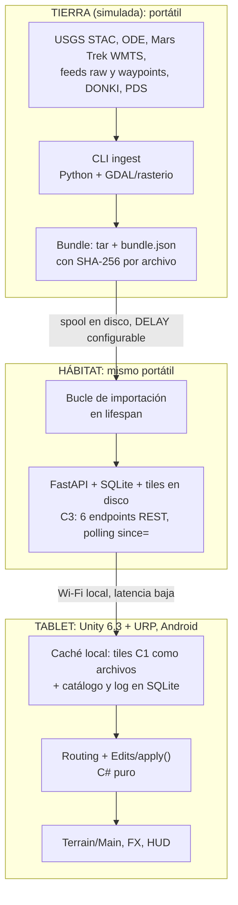
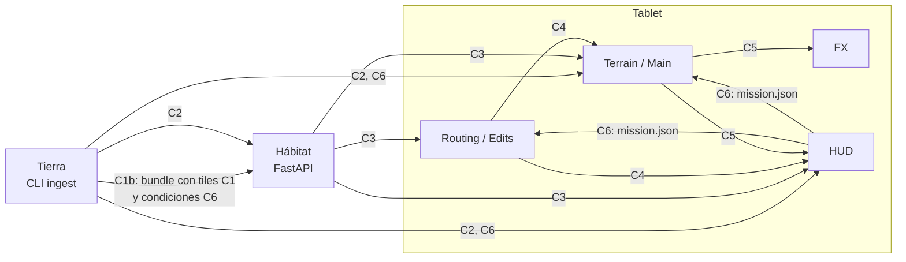
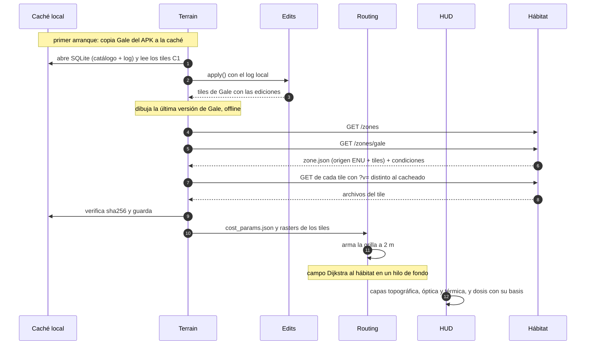
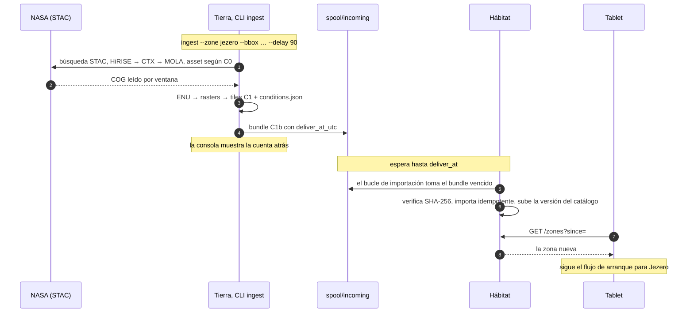
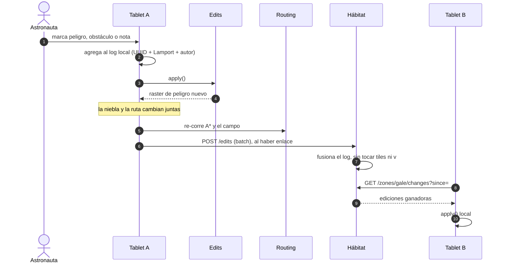
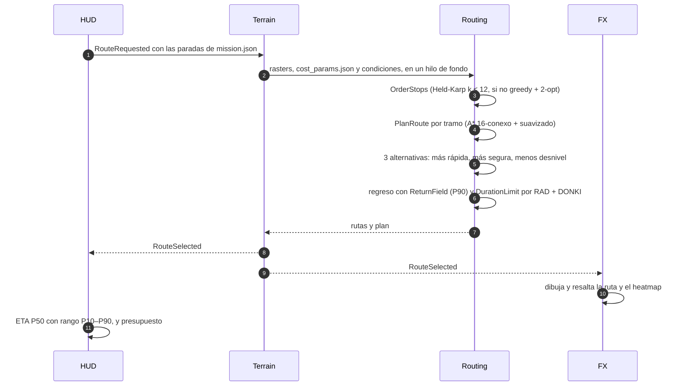

# Los ambientes

El sistema corre en tres ambientes. Esta página dice qué es cada uno, por qué son tres, qué viaja
entre ellos y qué contratos los unen, y sigue los cuatro flujos que los cruzan. Cómo funciona cada
ambiente por dentro está en su página: [Tierra](./tierra.md), [Hábitat](./habitat.md) y
[Tablet](./tablet.md).

## Los tres ambientes

| Ambiente | Dónde corre | Qué hace |
|---|---|---|
| **Tierra** (simulada) | un proceso en un portátil | ingiere datos de NASA con el CLI `ingest`, produce tiles y condiciones, y los empaqueta en bundles que deja en un spool |
| **Hábitat** | un servidor FastAPI en un portátil | importa los bundles, sirve zonas y tiles por REST y fusiona el log de ediciones |
| **Tablet** | app Unity en Android, offline-first | dibuja el terreno, calcula rutas, aplica ediciones y muestra los indicadores |

Dentro de la tablet hay cinco componentes, que el resto de la guía nombra así: `Routing` (rutas y
costo), `Edits` (`apply()`), `Terrain` (terreno, caché, cliente REST, orquestación y escena `Main`),
`FX` (efectos visuales y dibujo de rutas) y `HUD` (indicadores, misión y modo edición).

- En la demo, Tierra y hábitat corren en el **mismo portátil**.
- **Solo Tierra dispara la ingesta.** El hábitat no ejecuta ingesta de NASA: solo importa bundles.
- Las actualizaciones de DONKI también llegan como bundles (`kind: "conditions"`), con su retardo.

*Dibuja: `docs/guide/chapters/ambientes.md` § Los tres ambientes; `docs/guide/chapters/ambientes.md` § Qué viaja entre ambientes y con qué retardo*

## Por qué son tres (D11)

**El diseño es edge-first en tres niveles**: la tablet calcula rutas y `apply()` en C# puro
(netstandard2.1, sin `UnityEngine`); el hábitat ofrece optimizaciones largas opcionales, siempre
con un fallback local en la tablet; la Tierra se simula con un retardo `DELAY`.

- El retardo Tierra–Marte (~750 s de ida) justifica no depender de la Tierra. No justifica dejar de
  depender del hábitat, que tiene latencia local.
- La librería de rutas y ediciones se prueba con `dotnet test`, fuera del editor de Unity.
- ION (el DTN de JPL) se menciona en el pitch y no se implementa. El manifest del bundle refleja la
  identidad BPv7 ([RFC 9171](https://www.rfc-editor.org/rfc/rfc9171.html)).

Factibilidad en 48 h: media-alta *(inferencia)*.

No hay benchmarks publicados de la librería en la tablet (**NO VERIFICADO**). El orden de los planes
de rendimiento está en [Tablet](./tablet.md), sección "Rutas (D7)".

## Qué viaja entre ambientes y con qué retardo

| Tramo | Qué viaja | Medio | Retardo |
|---|---|---|---|
| Tierra → Hábitat | bundles (C1b): una zona completa, una actualización de zona o unas condiciones | spool en disco | `DELAY` configurable: 750 s real, o 60–90 s para el video |
| Hábitat → Tablet | lista de zonas, `zone.json` (con los `LayerSource` y los pines POV) y condiciones, tiles, imágenes POV, ediciones ganadoras (C3) | Wi-Fi local, polling `since=` | latencia baja |
| Tablet → Hábitat | ediciones en batch (`POST /edits`) | Wi-Fi local, cuando hay enlace | latencia baja |

Nada viaja de la tablet a la Tierra: la tablet nunca pide una zona. El hábitat tampoco expone
"bundles pendientes", porque un hábitat real no sabe qué viene en camino.

## Quién calcula qué

Cada cálculo tiene un solo ambiente. Quién es su dueño está en
[Reparto del trabajo](./reparto.md).

| Cálculo | Ambiente | Contrato |
|---|---|---|
| Búsqueda STAC, selección de asset por datum, lectura COG por ventana, reproyección a ENU | Tierra | C0, C2 |
| Pendiente, relieve local y raster de peligro (único, `uint8` 0–255) sobre float32 | Tierra | C1 `rasters` |
| Cuantización uint16 con escala/offset por tile, borde compartido | Tierra | C1 |
| `conditions.json` (radiación: RAD base + modificadores DONKI), y el escenario `SEP` | Tierra | C6 |
| Pines POV: situar cada imagen de rover y reducirla | Tierra | C1 `zone.json`, C2 |
| Empaquetar el bundle y escribirlo en el spool (`.partial` + `fsync` + `os.replace`) | Tierra | C1b |
| Numerar `zone_version` y la versión de cada tile | Tierra | C1, C1b |
| Importar el bundle (spool, SHA-256, idempotente por `bundle_id`), adoptar las versiones que trae, publicar cambios | Hábitat | C3, C1b |
| Merge del log de ediciones (LWW / max hazard / tombstones) sobre metadatos, sin aritmética de raster | Hábitat (Python) | C3 |
| Optimización multi-astronauta/rover (OR-Tools), opcional | Hábitat | C4 |
| `apply(baseTile, edits[]) → tile'` (función pura C#, ensamblado `Edits`; ordena por `(lamport, author, uuid)`) | Tablet, `Edits` | C1, C3 |
| **Fórmula del costo** (Tobler + bloqueos + peligro ámbar), única implementación | Tablet, `Routing` | C4 `cost_params.json` |
| A\*, suavizado, campo al hábitat, 3 alternativas, orden de paradas | Tablet, `Routing` | C4 |
| Límite de duración por radiación sobre la ruta | Tablet, `Routing` | C4, C6 |
| Caché local (archivos + SQLite), llamar a `apply()` al recibir `changes`, refrescar `_HazardTex` | Tablet, `Terrain` | C3, C5 |
| Orquestar rutas y ediciones: entregar los rasters a `Routing`, llamarlo en un hilo de fondo, completar y guardar cada edición, emitir los eventos | Tablet, `Terrain` | C4, C5 |
| Modo edición: gestos, polígono en punto fijo y diálogo de confirmación | Tablet, `HUD` | C3, C5 |
| LOD, skirts, material del terreno (incluye el tinte de niebla lejana), cámara orbital | Tablet, `Terrain` | C5 |
| Niebla cercana, holograma, heatmap (shaders) y dibujo de la ruta (prefab `Routes`) | Tablet, `FX` | C5 |
| Indicadores topográfico, óptico, térmico y radiación (dosis); pines POV con crédito | Tablet, `HUD` | C4, C5, C6 |

## Los contratos como interfaces

Un contrato es la interfaz entre dos ambientes o entre dos componentes de la tablet. Cada uno vive
en `contracts/` con su fixture; tipos, unidades y CRS son explícitos. Lo marcado *(inferencia de
diseño)* en su página es propuesta y se confirma al fijar el contrato. Cómo se fija y cómo se
cambia: [Convenciones](./convenciones.md), sección "Cómo se fija un contrato".

| Contrato | Qué fija | Quién lo produce | Quién lo consume | Contenido completo |
|---|---|---|---|---|
| **C0** convenciones | CRS, datum, normalización, unidades, tiempo | todos lo cumplen | todos | [Convenciones](./convenciones.md), "Datos (C0)" |
| **C1** tile | `tile.json`, `zone.json` (con `layer_sources[]` y `pov[]`), altura `uint16`, rasters de pendiente, relieve y peligro | Tierra | Hábitat, `Routing`, `Terrain`, `FX`, `HUD` | [Tierra](./tierra.md), "Tiles (C1)" |
| **C1b** bundle | `bundle.json`, tar, nombre en el spool | Tierra | Hábitat | [Tierra](./tierra.md), "Bundle y spool con DELAY (C1b)" |
| **C2** `LayerSource` | descripción de cada fuente de datos y su licencia | Tierra | Hábitat, `Terrain`, `HUD` | [Tierra](./tierra.md), "Fuentes de datos (D10, C2)" |
| **C3** REST | 6 endpoints, esquema de `Edit`, reglas de merge | Hábitat | `Routing`/`Edits`, `Terrain`, `HUD` | [Hábitat](./habitat.md), "Los endpoints (C3)" |
| **C4** rutas | `cost_params.json`, API de rutas, `Edits.Apply` | `Routing`/`Edits` | `Terrain`, `HUD` | [Tablet](./tablet.md), "Contrato de rutas (C4)" |
| **C5** escena | prefabs, propiedades de material, bus de eventos | `Terrain` | `FX`, `HUD` | [Tablet](./tablet.md), "Contrato de escena (C5)" |
| **C6** condiciones y misión | `conditions.json` (radiación) y `mission.json` | Tierra (condiciones), `HUD` (misión) | `Routing`, `Terrain`, `HUD` | [Tierra](./tierra.md), "Condiciones (C6)"; [Tablet](./tablet.md), "Misión (C6)" |

*Dibuja: `docs/guide/chapters/ambientes.md` § Los contratos como interfaces*

C0 no aparece como flecha porque lo cumplen todos. Los tiles C1, los `LayerSource` de C2 (dentro
de `zone.json`) y las condiciones de C6 llegan a la tablet a través del hábitat: viajan dentro del
bundle y se sirven por C3.

Dentro de la tablet, solo `Terrain` habla HTTP con el hábitat. `Routing`/`Edits` y el `HUD`
consumen de C3 el esquema de `Edit`, no la red. `Terrain` lee `zone.json` (con sus `LayerSource`)
y `conditions.json` a las clases de C5, y el `HUD` los recibe por el bus
([Tablet](./tablet.md), sección "Orquestación").

## Los cuatro flujos

### Arranque

1. La tablet abre el SQLite local (catálogo + log), lee los tiles C1 de
   `persistentDataPath/zones/…`, aplica el log con `apply()` y dibuja la última versión de Gale
   (offline). En el primer arranque, antes copia Gale desde el APK a esa carpeta
   ([Tablet](./tablet.md), sección "Caché local").
2. Si hay hábitat: `GET /zones` → `GET /zones/{id}` (origen ENU + tiles + condiciones).
3. Descarga los tiles con `?v=` distinto al cacheado y verifica su `sha256`.
4. `Terrain` entrega a `Routing` `cost_params.json` y los rasters; `Routing` arma la grilla a 2 m y
   calcula el campo Dijkstra al hábitat (el `habitat_enu_m` de `zone.json`) **en un hilo de
   fondo**.
5. El `HUD` muestra las capas topográfica, óptica y térmica, y la dosis de radiación con su `basis`.

*Dibuja: `docs/guide/chapters/ambientes.md` § Arranque*

### Zona nueva

Cumple U2 y S8: Jezero se ingiere en vivo.

1. En el proceso Tierra se corre `ingest --zone jezero --bbox … --delay 90`.
2. STAC (HiRISE → CTX → MOLA, asset según C0) → COG por ventana → ENU → rasters → tiles C1 +
   `conditions.json`.
3. Tierra empaqueta el bundle (C1b) y lo deja en `spool/incoming/` con `deliver_at_utc`; la consola
   de Tierra muestra la cuenta atrás.
4. Vencido `deliver_at`, el bucle de importación del hábitat verifica los SHA-256, importa el
   bundle de forma idempotente y sube la versión del catálogo.
5. La tablet detecta la zona en el polling de `GET /zones?since=` y sigue el flujo de arranque para
   ella.

*Dibuja: `docs/guide/chapters/ambientes.md` § Zona nueva*

### Edición

Cumple U3.

1. El astronauta marca en el `HUD` un peligro, un obstáculo o una nota.
2. `Terrain` agrega la edición al log local (UUID + Lamport + autor) y la aplica con `apply()`: el
   raster de peligro cambia, así que la niebla y la ruta cambian juntas.
3. `Terrain` hace que `Routing` re-corra A\* y el campo.
4. Al haber enlace: `POST /edits` (batch).
5. El hábitat fusiona el log (LWW / max hazard wins / tombstones) sin tocar tiles ni `v`. Las otras
   tablets reciben las ediciones ganadoras por `GET /zones/{id}/changes?since=` y aplican `apply()`
   localmente.

*Dibuja: `docs/guide/chapters/ambientes.md` § Edición*

### Ruta

Cumple U4, S5 y R4.

1. El `HUD` entrega las paradas de `mission.json` a `Terrain`, que llama a `Routing` en un hilo de
   fondo.
2. `OrderStops` (Held-Karp con k ≤ 12; si no, greedy + 2-opt) en modo TSP u orienteering con
   presupuesto de tiempo.
3. `PlanRoute` por tramo (A\* 16-conexo + suavizado).
4. Las 3 alternativas, en este orden: más rápida, más segura, menos desnivel.
5. Chequeo de regreso con `ReturnField` (v₀ P90) y límite de duración por RAD + DONKI
   (`DurationLimit`).
6. `Terrain` emite `RouteSelected`: `FX` dibuja y resalta la ruta y el heatmap; el `HUD` muestra la
   ETA (P50, con rango P10–P90) y el presupuesto.

*Dibuja: `docs/guide/chapters/ambientes.md` § Ruta*
