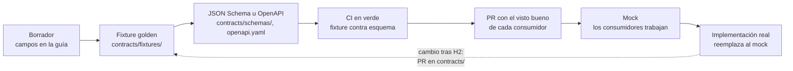

# Convenciones

Esta página es lo que el equipo sigue en H0–2 para fijar los contratos, y lo que cumple después
todo el código. Dice cómo se fija un contrato, cuáles hay y en qué orden, y cada convención común:
datos, API, protocolos, ediciones, repositorio, código, Unity y presentación. El contenido de cada
contrato (sus campos) está en la página de su ambiente; aquí está lo que comparten.

## Cómo leer las marcas

| Marca | Qué significa |
|---|---|
| sin marca, o con fuente | viene del diseño: las decisiones D1 a D11, que esta guía enuncia en la página de cada ambiente. Cómo se citan sus fuentes: [Contexto del reto](./contexto.md), sección "Cómo leer las fuentes" |
| *(equipo)* | *decidido por el equipo, 2026-11-12*: no viene del diseño ni tiene fuente externa; es una decisión |
| *(propuesta)* | nadie del equipo lo decidió: es la propuesta de quien redactó la página, y vale hasta que su dueño la cambie |
| *(inferencia de diseño)*, **NO VERIFICADO** | igual que en el resto de la guía |

Una sección que abre con "*(equipo)*" lleva esa marca en todo lo que afirma, salvo lo que marque
otra cosa.

## Cómo se fija un contrato

Un contrato está fijado cuando sus entregables están en `main`. Hasta entonces es un borrador.

*Dibuja: `docs/guide/chapters/convenciones.md` § Cómo se fija un contrato*

### Entregables

| Entregable | Dónde va | Para qué contratos |
|---|---|---|
| Fixture golden | `contracts/fixtures/<caso>/` | todos |
| JSON Schema | `contracts/schemas/<nombre>.schema.json` | C1, C1b, C2, C6 (`conditions` y `mission`), `Edit`, `edit_log` y los cuatro cuerpos de respuesta de C3, `cost_params`, `route` y `plan` de C4 |
| OpenAPI 3.1, en YAML a mano | `contracts/openapi.yaml` | C3 |
| Validación en CI | el job de contratos (sección "Repositorio y flujo de trabajo") | todos |
| Mock | para C3, Prism en los endpoints JSON y un stub en los de archivos (sección "Mock y validación"); el propio fixture para los demás | todos |

- **Qué esquema valida a cada fixture** *(equipo)*: lo dice `contracts/schemas/map.json`, un
  objeto `{patrón de ruta: nombre de esquema}`, que es lo único que lee el job de contratos. P6 lo
  escribe entero antes de H0, con los fixtures de la tabla de abajo, así que nadie lo toca en H0–2.
  Un fixture que no es JSON no tiene fila: `validate.py` lo acepta solo si lo reconoce, y su
  contenido lo prueba el test de su dueño. `routing/costgrid_synth.bin` lo reconoce por su nombre
  y exige que no esté vacío; que está al día lo prueba `CostgridSynthIsUpToDate`, en
  `dotnet test`. Un `.gitkeep` vacío no es un fixture y se ignora.
  `edit_log` es `{schema_version, edits[]}`: vale para `log_in.json`, `log_merged.json` y
  `edits_NN.json`.
- **Cualquiera valida en local antes de abrir su PR** con `uv run contracts/validate.py`, el mismo
  script que corre el job de contratos (sección "CI").
- **Los fixtures sintéticos comparten coordenadas** *(equipo)*, para que el tile, la grilla, la
  ruta y la misión de prueba encajen en una misma escena:

| Qué | Valor |
|---|---|
| Zona `synth` | `zone_version` = `1` en todos sus fixtures; un tile de 256 m; origen en su centro; `extent_enu_m` = `[-128, -128, 128, 128]`; `habitat_enu_m` = `[-100, -20]`; `origin_height_m` = `12.5` |
| Altura del tile | sobre el areoide, en metros: `20 · (e + 128) / 256 + 5 · (n + 128) / 256`. Vale 0 en la esquina suroeste y 25 en la noreste. `height.scale` = `0.0009765625` (1/1024) y `height.offset` = `0`: cada muestra es exacta, sin redondeo |
| Peligro rojo del tile | 255 en e 40…100, n 40…100; ahí `slope` = 20 |
| Peligro ámbar del tile | 128 en e −100…−60, n −100…−60 |
| `nodata` del tile | las 16 × 16 muestras de e 113…128, n −128…−113 |
| Capas del tile | con `c` la columna y `r` la fila de la muestra (C0): `ortho` = `min(c, 255)`; `thermal` = `min(256 − r, 255)`, con `scale` = `2`, `offset` = `100` y `unit` = `"J m-2 K-1 s-1/2"` en `zone.json`; `thermal_ir` = un damero de cuadros de 32 muestras, con 64 y 192, y `qualitative: true`. Las tres valen 0 en el `nodata` |
| `costgrid_synth.bin` | 129 × 129 nodos de 2 m, con el nodo `(0, 0)` en `[-128, -128]`. Es la `CostGrid` que `BuildGrid` da para ese tile: su rampa, su peligro, su `slope` y su `nodata`. Es un solo tile, así que el perímetro no es `nodata`: las muestras de la ventana 3 × 3 que caen fuera se ignoran |
| `expected_route.json` | la recta de `[-100, -20]` a `[100, -20]`, sobre la rampa: sube 15,625 m y no pisa peligro |
| `mission.json` y `expected_plan.json` | base `[-100, -20]`; paradas `s1` en `[0, -20]` y `s2` en `[100, -20]`, con `science_value` 5 y 8 y `dwell_s` 600 las dos; `budget` = `{t_s: 14400, dose_uGy: 50}`; `mode` = `"TSP"` *(propuesta)* |
| `conditions.json` | `value` = `6.0`, `uncertainty` = `0.2`, `basis` = `"measured"`, y un modificador `WSAEnlilSimulations` de `factor` `0.95` *(propuesta)* |

Todos los rangos de la tabla incluyen sus dos extremos: `e 40…100` son las muestras de e = 40 a
e = 100.

El tile y la grilla salen de las mismas fórmulas, las de esta tabla, y no uno del otro *(equipo)*:
P1 genera el tile y P3 la grilla, cada uno con su script, en su carpeta (`ingest/` y `Routing/Tests~/`), sin esperarse. Que coinciden lo
comprueba un test de `Routing/` cuando existe `BuildGrid` (H4–6): `BuildGrid` sobre el tile
sintético da, byte a byte, los arrays de `costgrid_synth.bin`.

- **El contrato es el fixture.** Si un campo no está en el fixture golden, no existe. No se usa
  Pact ni protobuf.
- C4 y C5 son además API de C# y de escena: su entregable es la firma pública en el ensamblado y,
  para C4, sus goldens. Los goldens de C4 que dependen de código entran después de H2:
  [Tablet](./tablet.md), sección "Contrato de rutas (C4)".
- La estructura de `contracts/` es por tipo de archivo, con nombres en snake_case *(equipo)*:

| Ruta | Contenido |
|---|---|
| `contracts/openapi.yaml` | C3 |
| `contracts/schemas/` | `tile`, `zone`, `bundle`, `layer_source`, `edit`, `edit_log`, `conditions`, `mission`, `cost_params`, `route`, `plan`, y los cuerpos de C3: `zones_response`, `zone_response`, `edits_ack`, `changes_response` |
| `contracts/fixtures/tile_synth_0_0_0/` | un tile C1 sintético, con las tres capas |
| `contracts/fixtures/zone/` | el `zone.json` de la zona sintética `synth`, de un solo tile (el anterior), con sus tres `layers[]`, un `LayerSource` por cada `source_id` que usa (el del tile, los de las tres capas y el del pin), un pin POV y su imagen en `pov/` |
| `contracts/fixtures/bundle_synth/` | un bundle C1b sintético de `kind: "zone_full"`, sin empaquetar: `bundle.json` + `data/` con copias de los fixtures de zona, tile y condiciones *(equipo)* |
| `contracts/fixtures/layer_source/` | un `LayerSource` de ejemplo |
| `contracts/fixtures/edits/` | `base_tile/` + `edits_NN.json` + `expected_NN.sha256` |
| `contracts/fixtures/merge/` | `log_in.json` → `log_merged.json`; su forma, en [Hábitat](./habitat.md), sección "Log de ediciones y merge (D5)" |
| `contracts/fixtures/routing/` | `cost_params.json`, `costgrid_synth.bin`, `expected_route.json`, `expected_plan.json` |
| `contracts/fixtures/conditions/`, `contracts/fixtures/mission/` | un `conditions.json` y un `mission.json` de ejemplo, con los valores de la tabla de arriba |
| `contracts/fixtures/api/` | *(equipo)* los cuerpos de respuesta de C3, completos: `zones.json`, `zone.json`, `edits_ack.json` y `changes.json`. Los escribe P2. Son los ejemplos de `openapi.yaml` y lo que lee la tablet cuando trabaja sin red |

### Quién lo firma *(equipo)*

1. Quien escribe el contrato abre un PR con el fixture, el esquema y, en C3, el OpenAPI. Quién lo
   escribe está en la sección "Qué contratos se fijan y en qué orden"; casi siempre es el productor.
2. El CI de contratos queda en verde.
3. Cada consumidor directo da su visto bueno en el PR. Si quien lo escribió no es el productor, el
   productor también lo da.
4. Se fusiona. Lo marcado *(inferencia de diseño)* o *(propuesta)* en la página del contrato queda
   confirmado o corregido en ese PR. Lo marcado *(equipo)* se transcribe tal cual.

En H0–2 el equipo está en la misma sala: el visto bueno se da de palabra, y quien abrió el PR lo
anota en él y lo fusiona. Nadie espera una revisión escrita.

### Cómo se cambia después de H2 *(equipo)*

1. El productor abre un PR que toca `contracts/`: esquema, fixture y versión (`info.version` en C3,
   `schema_version` en un JSON).
2. Lo anuncia de viva voz en la sala, porque el equipo trabaja presencial, y deja un comentario
   en el PR.
3. Los consumidores tienen 30 minutos desde ese comentario; el silencio es un sí.

- **Solo entran cambios aditivos**: campos opcionales nuevos.
- Un cambio que rompe a un consumidor entra solo en un punto de integración (cada 3–4 h) y con el
  sí explícito de todos sus consumidores.
- Si no hay acuerdo, decide P4, el integrador.

## Qué contratos se fijan y en qué orden

Todos quedan fijados en H0–2. **El orden no es una cola**: un contrato solo espera a los que
contiene, y los demás se escriben a la vez desde H0 *(equipo)*.

| Contrato | Produce | Lo escribe en H0–2 | Consumen | Espera a | Contenido | Abierto al fijarlo |
|---|---|---|---|---|---|---|
| **C0** convenciones | todos | ya está escrito | todos | nada | esta página, sección "Datos (C0)" | nada |
| **C1** tile y `zone.json`, en dos PR | P1 | P1 | P2, P3, P4, P5, P6 | el tile, nada; la zona, C2, para sus `LayerSource` | [Tierra](./tierra.md), sección "Tiles (C1)" | nada |
| **C1b** bundle | P1 | P1 el esquema, P6 el fixture; lo revisa P2 | P2 | C1 y C6 `conditions.json`: el fixture los copia | [Tierra](./tierra.md), sección "Bundle y spool con DELAY (C1b)" | el nombre del motivo de rechazo por hash |
| **C2** `LayerSource` | P1 | P6 | P2, P4, P6 | nada | [Tierra](./tierra.md), sección "Fuentes de datos (D10, C2)" | nada |
| **C6** `conditions.json` | P1 | P5 | P3, P4, P6 | nada | [Tierra](./tierra.md), sección "Condiciones (C6)" | dosis B o E como representativa (**E14**) |
| **C3** REST | P2 | P2 | P3, P4, P6 | C1 y C6 `conditions.json`, solo para las respuestas de zona | [Hábitat](./habitat.md), sección "Los endpoints (C3)" | la lista completa de `code` de error, que se escribe en `openapi.yaml` |
| **C4** rutas | P3 | P3 | P4, P6 | C1 y el `Edit` de C3, solo para `fixtures/edits/`; el resto, nada | [Tablet](./tablet.md), sección "Contrato de rutas (C4)" | b de Tobler (**NO VERIFICADO**) |
| **C5** escena | P4 | P4 | P5, P6 | la firma de C4 (los tipos `Route` y `Plan`), que P3 fusiona antes de H0:45; los tipos de C1 y C6 los escribe P4 desde las tablas de la guía | [Tablet](./tablet.md), sección "Contrato de escena (C5)" | nada |
| **C6** `mission.json` | P6 | P6 | P3, P4, P6 | nada | [Tablet](./tablet.md), sección "Misión (C6)" | nada |

Cómo se reparte la ventana *(equipo)*:

- **P6 escribe C2 primero**, en los primeros 20 minutos: es transcribir a esquema y fixture la
  tabla de campos de [Tierra](./tierra.md), sección "Fuentes de datos (D10, C2)". Después escribe
  `mission.json`. P1 sigue siendo el productor de C2: lo aprueba, y desde H2 lo mantiene.
- **P1 escribe solo C1 y el esquema de C1b. C1 son dos PR** *(equipo)*:
  1. el tile sintético y `tile.schema.json`, que no esperan a nadie y están en `main` antes de
     H0:45. Es lo único de C1 que necesitan P3 (`fixtures/edits/`), P4 y P5;
  2. el fixture de zona y `zone.schema.json`, cuando C2 está en `main`. Lo necesitan P2 (las
     respuestas de zona) y P6 (`bundle_synth/`).
- El fixture `bundle_synth/` lo arma P6 cuando la zona de C1 y C6 están en `main`: es copiar los
  fixtures y calcular sus hashes. P2 lo revisa como consumidor y escribe contra él la prueba de
  importación. Los experimentos E12 y E13 de P1 se corren antes de H0, no en H0–2.
- **P5 escribe C6 `conditions.json`** (esquema y fixture), corre E14 y hace el sondeo de endpoints
  de NASA *(equipo)*: en H0–2 no tiene otro contrato. El fixture es de la zona `synth` y lleva
  un valor de ejemplo, así que entra en `main` en la primera media hora sin esperar a E14, que
  solo decide el dato real de Gale. P1 lo aprueba, y desde H2 lo mantiene.
- **P2 no espera a P1 para empezar**: el esquema de `Edit`, el golden de merge, el stub de archivos
  y los endpoints de ediciones no contienen a C1. El esquema de `Edit` está en `main` antes de
  H0:45 *(propuesta)*: lo esperan P3, para `fixtures/edits/`, y el golden de merge. Las respuestas de zona de `openapi.yaml` las
  cierra cuando C1 está en `main`.
- **P3 fusiona primero la firma de C4**, antes de H0:45: los tipos y las llamadas, sin cuerpo.
  Los dos paquetes vacíos ya están en `main` desde antes de H0 (sección "Forja y carpetas"), así
  que en esos 45 minutos solo escribe tipos y firmas. `Route` y `Plan` existen solo en `Routing`. Deja `fixtures/edits/` para el final de la ventana,
  cuando C1 y el esquema de `Edit` están en `main`.
- **P4 arranca C5 en H0** por lo que no usa tipos de C4 *(equipo)*: `AppConfig`, `ShaderIds`,
  `MapQuery`, las clases de datos y los eventos que no llevan tipos de `Routing` ni de `Edits`.
  Nada de eso se escribe antes de H0. Cuando la firma de P3 está en `main`, cierra los cuatro
  eventos que la usan (`RouteRequested`, `RouteSelected`, `EditRequested` y `EntitiesChanged`) y
  escribe el cargador de fixtures.
- **La cadena más larga** es C2 → la zona de C1 → C1b y las respuestas de zona de C3. Si un PR de
  P1 no está en `main` en H1:30, quien lo espera ramifica desde la rama de ese PR, y su PR se
  fusiona detrás del de P1 *(equipo)*: así el CI de contratos encuentra el esquema que falta. No
  se fusiona nada con el CI en rojo.

Qué une cada contrato, por ambiente y componente: [Los ambientes](./ambientes.md), sección "Los
contratos como interfaces". Quién es cada persona: [Reparto del trabajo](./reparto.md).

## Reglas de todo el equipo

- **Una carpeta por dueño.** `Main.unity` solo lo toca P4. Cada prefab y cada material tiene un
  dueño exclusivo: UnityYAMLMerge solo fusiona bien `.unity`, `.prefab` y `.meta`; `.mat` y
  `.asset` no. Force Text + Smart Merge + Git LFS para binarios.
- **Un único raster de peligro** (`rasters.hazard`, `uint8` 0–255, de P1). P3 lo lee para bloqueos
  y penalizaciones; P5 lo lee como `_HazardTex` (R8). Lo que se ve como niebla es lo que la ruta
  evita.
- **Un cálculo, una implementación.** La fórmula del costo y `apply()` viven solo en C# (P3); el
  hábitat no hace aritmética de raster.
- **Las versiones de tile solo cambian con bundles.** Una edición nunca cambia `version` ni `?v=`.
- **Nada modelado parece medido.** Todo valor de radiación lleva `basis`; las capas cualitativas
  llevan `qualitative: true`.
- **Integración por reemplazo de mocks.** Se cambia un mock por la implementación real cuando
  existe, no todos a la vez. Merge cada 3–4 h; un build roto en la tablet bloquea merges.
- **Versiones fijadas**, que no se suben durante las 48 h:

| Herramienta | Versión | Por qué esa |
|---|---|---|
| Unity | 6000.3.28f1 exacta | [Tablet](./tablet.md), sección "Motor y ficha del dispositivo (D1)" |
| Prism (`@stoplight/prism-cli`) | 5.16.0 | sección "API (C3)" de esta página |
| Node | ≥ 24.18 | lo exige Prism 5.16.0 (registro npm, S10) |
| C# de `Routing` y `Edits` | netstandard2.1, sin `UnityEngine` | [Tablet](./tablet.md), sección "Rutas (D7)" |
| Python | 3.12, con `uv` y lockfile commiteado | *(equipo)* |
| SDK de .NET | 10.0.404, fijado en `global.json` | *(equipo)*; comprobado con `Routing` y `Edits`: sección "Forja y carpetas" |

## Datos (C0)

C0 lo cumplen todos los ambientes.

### CRS, datum y unidades

| Tema | Regla |
|---|---|
| **Horizontal** | CRS geográfico IAU_2015:49900. Los COG fuente vienen en IAU_2015:49910 (equirectangular, esfera R = 3 396 190 m, clon 0). **Latitud planetocéntrica, longitud este en ±180** (grados decimales) |
| **Local** | ENU por zona en metros (`float64` en JSON), con el origen en `zone.json` |
| **Vertical** | **metros sobre el areoide** (datum MOLA / Mars 2000) |
| **Datum** | asset por prioridad: HiRISE `dtm` → CTX `geoid_adjusted_dem` → CTX `dtm` (ítems que solo traen ese). **Nunca CTX `dem`** (esfera, ~570 m de offset) |
| **Aborto** | la ingesta aborta si el DTM elegido difiere > 100 m de MOLA o de HiRISE en los puntos de control (E13) |
| **Una sola fuente** | dentro del área planificable se usa una sola fuente DTM; CTX y MOLA solo rellenan contexto visual |
| **Normalización** | MOLA PDS 0–360 → ±180; los IDs CTX van en °W (lon_E = 360 − W) |
| **CRS del archivo** | se lee del COG con GDAL (respaldo: `proj:projjson`), nunca de `proj:epsg` ni `proj:wkt2` |
| **Unidades** | SI (m, s, kg); dosis absorbida en Gy, tasa de dosis en `uGy/h` |
| **Tiempo** | UTC ISO-8601 (+ sol) |

Por qué existen las reglas de datum: [Tierra](./tierra.md), sección "Ingesta (D3)".

### Formatos *(equipo)*

| Tema | Regla |
|---|---|
| **Fechas** | siempre `YYYY-MM-DDTHH:MM:SSZ`: con `Z`, sin offset y sin fracción de segundo. Los nombres de campo del diseño (`t_utc`, `valid_from`…) no se renombran |
| **Sol** | nunca es clave de tiempo. Es un campo opcional `sol` (int, sol de la misión de origen) junto a la fecha UTC, solo donde la fuente lo trae (RAD, POV) |
| **Decimales en JSON** | ENU en metros con 3 decimales; lat/lon con 7; `scale` y `offset` de `height` sin recortar |
| **Redondeo a `uint8`** | `slope` y `roughness` se redondean **hacia arriba** y saturan a 255: es el lado seguro (R4), una pendiente de 15,2° queda en 16 y se bloquea |
| **Ausencia** | un campo opcional sin valor se omite; nunca `null`, `NaN` ni `Infinity` |
| **`nodata`** | solo `height` lo tiene (65535), y es la máscara de todo el tile. En una celda sin dato: `slope` = 0, `roughness` = 0, `hazard` = 255 |
| **Nombres de campo** | snake_case, con la unidad como sufijo cuando la lleva (`_m`, `_s`, `_utc`, `_deg`, `_cm`), como en el diseño |

### Identificadores

| Identificador | Formato |
|---|---|
| `zone_id` | slug `^[a-z][a-z0-9-]{1,31}$` (`gale`, `jezero`) *(equipo: la expresión)* |
| `bundle_id` | ULID, en mayúsculas *(equipo: las mayúsculas)* |
| `uuid` de una edición | UUIDv4 en minúsculas con guiones *(equipo)* |
| `entity_id` | UUIDv4, igual; lo crea la tablet que crea la entidad *(equipo)* |
| `LayerSource.id`, `source_id` | slug `misión-instrumento-producto` (`mro-hirise-dtm`) *(equipo)* |
| `author` | slug `^[a-z0-9-]{2,16}$` (`ev1`); ver la sección "Ediciones" *(equipo)* |

### Versionado de esquemas *(equipo)*

- JSON Schema 2020-12, el de OpenAPI 3.1.
- Todo archivo JSON lleva `schema_version` (int, empieza en 1) en su raíz, también
  `expected_route.json` y `expected_plan.json`. Los cuerpos de C3 no lo llevan: los versiona
  `info.version` *(propuesta)*.
- **Todo campo de una tabla de campos es obligatorio**, salvo el que dice "opcional" o "solo
  en…" *(propuesta)*.
- **Un `sha256` es siempre 64 caracteres hexadecimales en minúsculas** *(propuesta)*.
- **Estricto al producir, tolerante al leer**: los esquemas llevan `additionalProperties: false` y
  el CI valida con ellos lo que se produce; quien lee ignora los campos que no conoce.
- **Un esquema referencia a otro con un `$ref` relativo por nombre de archivo**
  (`"$ref": "layer_source.schema.json"`), y el CI carga todo `contracts/schemas/`.
- **Los ejemplos de `openapi.yaml` referencian los fixtures**, no los copian: cada respuesta JSON
  tiene un solo ejemplo, que es un `$ref` al archivo entero de `contracts/fixtures/api/`
  *(equipo)*. Como son fixtures con su fila en `map.json`, el job de contratos los valida igual
  que a los demás. Que Prism 5.16.0 resuelva un `$ref` a un archivo dentro de `examples` es
  **NO VERIFICADO** → **E10**, que P2 adelanta antes de H0 con un YAML de juguete.
- `fixtures/api/zone.json` y `bundle_synth/data/` contienen copias de otros fixtures. El job de
  contratos comprueba que cada copia es idéntica a su original *(propuesta)*.
- Quitar o cambiar un campo sube `schema_version` y pasa por "Cómo se cambia después de H2".

### Rejilla y archivos de un tile *(equipo)*

| Tema | Regla |
|---|---|
| `z` | **`z = 0` es siempre 1,000 m/px en ENU** *(equipo)*: Tierra remuestrea la fuente a esa rejilla, sea cual sea su resolución nativa (el DTM de Gale es de ~1,01 m). Cada nivel duplica `m_per_px` (1 · 2^z). La grilla de rutas y los vértices de las ediciones dan por hecho ese metro exacto |
| `x`, `y` | `x` crece al este e `y` al norte, desde la esquina suroeste del ENU de la zona |
| `origin_enu_m` | la esquina suroeste del tile |
| Tamaño | la zona no necesita ser potencia de 2 ni múltiplo de 256 m. La parte de un tile que sobresale de `extent_enu_m` se rellena como celda sin dato *(equipo)*: fila `nodata` de "Formatos", y 0 en las capas |
| Archivos | `tile.json`, `height.r16`, `slope.r8`, `roughness.r8`, `hazard.r8` y un archivo por capa de `layers[]` |
| Formato binario | crudo, sin cabecera, little-endian; 257 × 257 muestras, en los vértices de la celda |
| Orden de las muestras | por filas. **La fila 0 es el borde norte** y dentro de una fila la columna crece al este: la muestra de la fila `r` y la columna `c` está en el índice `r · 257 + c`. Vale para `height`, `slope`, `roughness`, `hazard` y todas las capas; es lo que significa `row_order: "north_up"` |
| Niveles `z > 0` *(equipo)* | cada muestra sale del nivel anterior: `height` y las capas toman la muestra `(2r, 2c)`; `slope`, `roughness` y `hazard`, el máximo de las 3 × 3 centradas en ella |

Los campos de `tile.json`: [Tierra](./tierra.md), sección "Tiles (C1)".

## API (C3)

Los endpoints y lo que devuelven: [Hábitat](./habitat.md), sección "Los endpoints (C3)". Aquí
está cómo se comportan todos.

### Lo que viene del diseño

- **Polling con `since=`**: no hay push. Los cambios de zonas se piden a `GET /zones?since=` y los
  de una zona a `GET /zones/{id}/changes?since=`.
- **`POST /edits` es idempotente por UUID**: reenviar una edición no la duplica.
- **`?v=` cambia solo al importar un bundle.**
- **No existen**: `/ingest` (la ingesta es el CLI de Tierra), "bundles pendientes" (un hábitat real
  no sabe qué viene en camino) ni SSE en el MVP (`GET /events` queda como extra, fuera del mock).

### Lo que decidió el equipo *(equipo)*

| Tema | Regla |
|---|---|
| **`since`** | un número de secuencia entero, monótono y único para todo el hábitat. Sube con cada bundle importado, edición fusionada o cambio de condiciones. La respuesta trae `next_since`; la primera llamada usa `since=0`. No depende de ningún reloj. El cliente guarda un cursor por flujo: uno para `/zones` y uno por zona para `changes` |
| **Paginación** | solo `changes`: `limit` (500 por defecto, 1000 máximo), y la respuesta trae `next_since` y `has_more`. El cliente repite hasta `has_more: false`. `limit` cuenta ediciones; `tiles[]` y `conditions` van enteros y solo en la última página, la de `has_more: false` *(propuesta)*. `GET /zones` no pagina |
| **Errores** | [RFC 9457](https://www.rfc-editor.org/rfc/rfc9457.html): `application/problem+json` con `title`, `status`, `detail` y un `code` propio en snake_case. Un solo esquema `Problem` en el OpenAPI |
| **Ack de `POST /edits`** | siempre 200, con un ack por UUID: `accepted`, `duplicate`, o `rejected` con su `code` (`confirmation_required`, `unknown_zone`). El batch entero solo se rechaza con 413 o 422 |
| **Batch** | máximo 200 ediciones y 1 MiB por petición. Si se supera, 413, y el cliente parte la cola en orden de `lamport` |
| **Versionado** | sin prefijo en la ruta. `info.version` es SemVer y vale `1.0.0` al fijar el contrato |
| **Cabeceras** | sin ETag ni caché HTTP: la caché se rige por `?v=` + `sha256`. Sin compresión |
| **`Content-Type`** | JSON y `tile.json`: `application/json; charset=utf-8`. Binarios del tile: `application/octet-stream`. Imágenes POV: `image/jpeg` |
| **Autenticación** | ninguna. El `author` viaja en el cuerpo y no se verifica; se declara en el texto de limitaciones |

| Código | Cuándo |
|---|---|
| 200 | todo acierto |
| 400 | parámetro mal formado |
| 404 | zona, tile, imagen o archivo inexistente, o `?v=` que ya no es el vigente |
| 413 | batch demasiado grande |
| 422 | cuerpo que no cumple el esquema |
| 503 | el hábitat aún no está listo |

### Ritmo del cliente *(equipo)*

| Tema | Valor |
|---|---|
| Polling | cada 2 s, a `/zones` y a `changes` de la zona activa |
| Espera máxima | 5 s en JSON; 30 s en un archivo de tile |
| Reintento tras fallo | a los 2, 4, 8 y 15 s (tope); vuelve a 2 s al primer acierto |
| Tile o imagen con `sha256` malo | 2 reintentos; después espera al siguiente ciclo |

### Mock y validación

C3 tiene dos mocks, porque **Prism no sirve binarios**: Prism 5.16.0 contesta a una respuesta
`application/octet-stream` con 6 bytes, el texto `string`, donde un `height.r16` tiene 132 098
(medido el 2026-11-12).

| Mock | Qué sirve | Comando | Puerto |
|---|---|---|---|
| Prism | los endpoints JSON | `npx @stoplight/prism-cli@5.16.0 mock --host 0.0.0.0 contracts/openapi.yaml` | 4010 |
| Stub de archivos | `GET /tiles/…` y `GET /zones/{id}/pov/…`, con los archivos de `contracts/fixtures/` | `uv run uvicorn mock_files:app --host 0.0.0.0 --port 4011`, desde `server/` *(equipo)* | 4011 |

- **`--host 0.0.0.0` es obligatorio**: sin él Prism escucha solo en `127.0.0.1` y la tablet no
  llega desde la red local (medido el 2026-11-12).
- El stub de archivos es un FastAPI de ~30 líneas, `server/mock_files.py` *(equipo)*. Lo escribe
  P2 en H0 y es el mock de tiles desde entonces. Sirve el tile de
  `contracts/fixtures/tile_synth_0_0_0/` como el tile `0/0/0` de la zona `synth` *(equipo)*.
- La app lee de su configuración dos URL, `habitat_url` y `files_url` *(equipo)*: con los mocks
  apuntan a 4010 y 4011; con el hábitat real, las dos apuntan al puerto 8000, porque el servidor
  sirve en el mismo puerto el JSON y los archivos. `config.default.json` trae las del hábitat real.
- Validación de la implementación real: `prism proxy` para los endpoints JSON; los de archivos se
  comparan por `sha256` con el fixture *(equipo)*.
- Prism 5.16.0 solo sirve `text/*` estático, sin streaming (leído en
  [`serialize.ts`](https://github.com/stoplightio/prism/blob/main/packages/http-server/src/serialize.ts),
  no ejecutado). Por eso SSE queda fuera del mock.
- El OpenAPI se escribe a mano; por qué, en [Hábitat](./habitat.md), sección "Servidor (D4)".
- Quién comprueba los dos mocks en H0: **E10**, en [Reparto del trabajo](./reparto.md).

## Protocolos entre ambientes

### Spool Tierra → hábitat *(equipo)*

Cómo se escribe y se importa un bundle: [Tierra](./tierra.md), sección "Bundle y spool con DELAY
(C1b)", y [Hábitat](./habitat.md), sección "Importación de bundles". Estas reglas completan el
protocolo.

| Tema | Regla |
|---|---|
| **Dónde** | `spool/` en la raíz del repositorio, fuera de git; `ingest` y el hábitat leen otra ruta de la variable `MM_SPOOL` *(equipo)*. Dentro, `state/` es de Tierra y el hábitat no lo lee: [Tierra](./tierra.md), sección "Tiles (C1)" |
| **Ritmo** | el hábitat revisa `spool/incoming/` cada 1 s |
| **Orden** | los bundles vencidos se importan en orden de nombre de archivo: `deliver_at`, luego `bundle_id` |
| **`zone_version`** | todo bundle, de cualquier `kind`, la sube. Qué versión lleva cada tile: [Tierra](./tierra.md), sección "Tiles (C1)" |
| **Chequeos, en este orden** | SHA-256; `bundle_id` ya importado; `expired`; `unknown_zone`; `stale` *(equipo)* |
| **Importado** | el tar se mueve a `spool/done/` |
| **Repetido** | un tar con un `bundle_id` ya importado no se importa ni se rechaza: se mueve a `spool/done/` *(equipo)* |
| **Rechazado** | va a `spool/rejected/`, junto a un `<nombre>.reason.json` con el motivo |
| **Reintento** | no hay. Tierra reemite con un `bundle_id` nuevo. El hábitat no avisa a Tierra: no hay canal de vuelta |

| Motivo de rechazo | Cuándo |
|---|---|
| hash | un SHA-256 de `bundle.json` no coincide |
| `expired` | `expires_utc` ya pasó cuando toca importarlo. Sin `expires_utc`, el bundle no caduca |
| `stale` | su `zone_version` es ≤ la ya importada |
| `unknown_zone` | es `zone_update` o `conditions` de una zona que aún no existe |

### Tablet ↔ hábitat *(equipo)*

- **Descubrimiento:** no hay mDNS. La app guarda `habitat_url`, `files_url` y `author` con la
  clase `AppConfig` de `Terrain`, que es parte de C5 ([Tablet](./tablet.md), sección "Contrato de
  escena (C5)"). La pantalla de ajustes y la que pide el `author` en el primer arranque son de
  P6, como UI del `HUD` *(equipo)*: leen y guardan con `AppConfig`, sin conocer el archivo.
- **Puertos:** hábitat real 8000; los mocks, 4010 y 4011 (sección "Mock y validación").
- **Sin enlace:** la app sigue funcionando con su caché y sigue sondeando.
- **Al recuperar el enlace**, en este orden:
  1. `POST /edits` con las ediciones pendientes, en orden de `lamport` y en batches.
  2. `changes?since=` de cada zona cacheada.
  3. `GET /zones?since=`.
- Una edición sin ack se reintenta siempre. Contra Prism, cuyo ack trae un `uuid` de ejemplo, el
  cliente da por aceptado el batch entero *(equipo)*. Lo reconoce así *(propuesta)*: una respuesta
  200 cuyos acks no nombran ningún `uuid` del batch.
- **Reloj de Lamport:** al crear una edición, contador + 1; al recibir una, max(local, recibido) + 1.

## Ediciones

El esquema de `Edit` y las reglas de merge: [Hábitat](./habitat.md), sección "Log de ediciones y
merge (D5)". Cómo se aplican: [Tablet](./tablet.md), sección "`apply()` (D5)".

### Catálogo de `op` *(equipo)*

| `op` | Entidad | `payload` |
|---|---|---|
| `hazard.set` | zona de peligro | `{polygon, level, confirmed}`: polígono, nivel `uint8` y `confirmed` (bool, opcional) |
| `obstacle.set` | obstáculo | `{polygon, confirmed}`; equivale a nivel 255 |
| `note.set` | nota | `{point, text}`: punto `[e, n]`, en el mismo punto fijo que un vértice, y texto |

En C#, la tabla entre `EditOp` y el texto del `op` es `EditOpText`, en `Edits`; nadie más la
escribe. `Terrain` descarta una edición cuyo `op` no reconoce `TryParse`, con una línea de log, y
sigue *(propuesta)*: [Tablet](./tablet.md), sección "Orquestación".

- **Ninguna edición cambia la altura.** El MVP no tiene op de parche de altura: una edición solo
  cambia el peligro o deja una nota.
- **Cada edición lleva el estado completo de su entidad**: LWW es reemplazar.
- Una entidad no cambia de `op`: el `op` de su primera edición vale para todas *(propuesta)*.
- **Borrar** es una edición de la misma `entity_id` con `tombstone: true`, el mismo `op` y el
  último `payload` *(equipo)*.
- **Geometría:** los vértices viajan como pares de enteros `[e, n]` en 1/256 de celda de 1 m,
  relativos al origen ENU de la zona. El `HUD` convierte al crear la edición; ningún float entra
  en `apply()`. Un polígono es un anillo simple de 3 o más vértices; el primero no se repite al
  final *(equipo)*.

### `author` *(equipo)*

- Cada tablet tiene un `author` fijo, que se escribe en el primer arranque y se guarda.
- Identifica al dispositivo, no a la persona. P4 reparte los valores para que no se repitan
  *(equipo)*: `ev1` a `ev6`, anotados en el README.
- En el desempate se compara como texto, byte a byte.

### Bajar un peligro *(equipo)*

- **Peligro de una celda = max(peligro base de Tierra, peligros vivos de las ediciones).**
- Las ediciones solo suben sobre el base. El base solo cambia con un bundle.
- El **nivel** de una entidad es el `level` de su `hazard.set`; un `obstacle.set` vale 255.
- **Bajar** una entidad es escribirle un nivel menor que el vigente, o borrarla.
- El **creador** de una entidad es el `author` de su primera edición. Viaja en el campo `creator`
  de cada edición de esa entidad.
- El creador baja su entidad sin más: es LWW normal.
- Quien no es el creador solo la baja con `confirmed: true` en el `payload`, que el `HUD` pone
  tras un diálogo.
- **Sin `confirmed`, esa edición se ignora entera**: la entidad queda como estaba, con su polígono
  y su nivel. La regla se evalúa al recorrer las ediciones de la entidad en orden
  `(lamport, author, uuid)`, igual en el merge del hábitat y en `apply()`.
- Un cambio de polígono que no baja el nivel es LWW normal, lo haga quien lo haga *(equipo)*.
- Una nota no tiene nivel: `note.set` es siempre LWW.

Qué ack da el hábitat a una edición ignorada: [Hábitat](./habitat.md), sección "Log de ediciones
y merge (D5)". Qué hace la tablet con ese ack: [Tablet](./tablet.md), sección "Orquestación".

## Repositorio y flujo de trabajo

*(equipo)*

### Forja y carpetas

Un solo repositorio en GitHub, público, con GitHub Actions:
[JCarlosHidalgo/martian-map](https://github.com/JCarlosHidalgo/martian-map). Quién lo prepara y
cuándo: [Reparto del trabajo](./reparto.md), sección "Antes de H0".

| Carpeta | Dueño | Contenido |
|---|---|---|
| `contracts/` | el productor de cada contrato | sección "Cómo se fija un contrato" |
| `ingest/` | P1 | el CLI de Tierra |
| `server/` | P2 | el hábitat |
| `Routing/`, `Edits/` | P3 | cada una con su `.csproj` netstandard2.1, un `package.json` + `.asmdef` sin referencias al motor, sus tests en `Tests~/` y un `Directory.Build.props` |
| `tablet/` | P4 | el proyecto Unity: `tablet/Assets/Terrain/` (P4), `tablet/Assets/FX/` (P5), `tablet/Assets/HUD/` (P6) y `Main.unity` (P4) |
| la raíz | P4 | `README.md`, `global.json`, `.gitignore`, `.gitattributes`, `.editorconfig` y `.github/workflows/` *(propuesta)*. El workflow de contratos lo escribe y lo mantiene P6 (sección "CI"). C4 necesita tres cosas de la raíz: `.gitignore` con `.build/`, `global.json` con el SDK 10 y `.gitattributes` con `* text=auto eol=lf` y los `binary` de la sección "Archivos". P3 las incluye en su PR, como copias exactas de las de `p4/skeleton`, para que P4 las apruebe y las dos ramas se fusionen sin conflicto *(propuesta de P3)* |
| `docs/` | P4 | esta guía. Se lee en GitHub desde el primer commit, que se hace antes de H0 ([Reparto del trabajo](./reparto.md), sección "Antes de H0"); quien quiera los diagramas dibujados levanta su Docmost local con `docs/guide/` |

Unity toma `Routing/` y `Edits/` como paquetes locales (`com.martianmap.routing` y
`com.martianmap.edits` *(equipo)*) desde `tablet/Packages/manifest.json`: el
código existe una sola vez, y `dotnet test` lo prueba fuera del motor.

Cada carpeta es a la vez un paquete Unity y un proyecto .NET, y eso exige dos cosas. Sin ellas,
Unity compila también `obj/` y los tests, y da 14 errores CS0579:

| Qué | Dónde va | Por qué |
|---|---|---|
| El proyecto de tests | `Tests~/` | Unity no importa una carpeta que termina en `~` |
| La salida de build (`obj/`, `bin/`) | `.build/`, ignorada en el `.gitignore` raíz *(propuesta de P3)* | Unity no importa una carpeta que empieza por `.`. Un `Directory.Build.props` fija `BaseIntermediateOutputPath` y `BaseOutputPath` |

Con las dos, Unity compila limpio y `dotnet test` pasa (comprobado el 2026-11-12 con Unity
6000.3.28f1 y el SDK de .NET 9). Con el SDK 10, que es el fijado, también: comprobado el
2026-11-14 con el SDK 10.0.404 (runtime 10.0.15), con build sin avisos, `dotnet test` de los dos
paquetes y FixtureGen sin diff; los tests, que apuntan a `net9.0` con `RollForward=Major`, corren
en el runtime 10. `global.json`, en la raíz, fija
`{"sdk": {"version": "10.0.404", "rollForward": "latestFeature"}}` *(propuesta de P3)*.

**Los dos paquetes vacíos quedan en `main` antes de H0** *(equipo)*: P3 los sube en cuanto el
repositorio existe, cada uno con su `.csproj`, `package.json`, `.asmdef`, `Directory.Build.props`
y `Tests~/`, sin ningún tipo dentro. Esa subida es la comprobación con el SDK 10. Con ellos en
`main`, P4 los añade a `tablet/Packages/manifest.json` y deja el job que los compila contra
netstandard2.1.

### Ramas, commits y revisión

- `main` está protegida: nadie hace push directo y el CI tiene que estar en verde. No exige
  aprobaciones escritas, porque el visto bueno se da de palabra *(propuesta)*.
- Ramas cortas `pN/tema` (`p3/astar`); PR con el CI en verde; squash merge.
- Mensaje de commit: `área: frase en imperativo` (`routing: add reverse Dijkstra field`).

| El PR toca | Quién aprueba |
|---|---|
| solo la carpeta de su dueño | nadie: el dueño lo fusiona |
| `contracts/` | la regla de "Cómo se cambia después de H2" |
| la carpeta de otro | ese dueño |

### CI

| Job | Obligatorio | Lo escribe y lo mantiene |
|---|---|---|
| contratos: cada fixture valida contra su esquema | en todo merge a `main` | P6 *(equipo)* |
| contratos: cada `sha256` escrito en un fixture coincide con su archivo | en todo merge a `main` | P6 *(propuesta)* |
| contratos: `openapi.yaml` es válido y sus ejemplos cumplen sus esquemas | en todo merge a `main` | P6 *(equipo)* |
| `Routing` y `Edits` compilan solo contra netstandard2.1 | en todo merge a `main` | P4 |
| `dotnet test` | si el cambio toca `Routing/` o `Edits/` | P4 |
| `pytest` | si el cambio toca `ingest/` o `server/` | P4 |

- **El job de contratos es un solo script**, `contracts/validate.py` *(propuesta)*: Python, con
  sus dependencias declaradas en el propio script, que `uv run` instala. Carga todo
  `contracts/schemas/`, lee `map.json` y valida cada fixture con la librería `jsonschema`;
  recalcula los `sha256` de `tile.json`, de `tiles[]` y `pov[]` de `zone.json` y de `files[]` de
  `bundle.json`; y valida `openapi.yaml` con `openapi-spec-validator`. Las herramientas son de
  P6: nadie más depende de cuáles son, solo de que el script exista.
- Un fixture que no casa con ningún patrón de `map.json` hace fallar el job.
- P6 lo deja en verde antes de H0 sobre un repositorio sin fixtures, cuando P4 ya creó las
  carpetas ([Reparto del trabajo](./reparto.md), sección "Antes de H0"). `openapi.yaml` no existe ese
  día: el script lo salta mientras falte.
- El build Android no corre en CI: lo hace P4 cada 4 h.

### Archivos

- Texto en UTF-8 sin BOM, fin de línea LF (`* text=auto eol=lf`), con salto final. `.gitattributes`
  marca como `binary` los `*.r8`, `*.r16`, `*.bin` y `*.jpg`, para que ningún `sha256` cambie
  *(propuesta)*. Un
  `.editorconfig` en la raíz. La excepción son los `.cs.meta` de Unity, que no llevan salto final:
  se commitean tal como los escribe Unity, y nadie los guarda desde un editor.
- **A Git LFS:** texturas, modelos, audio, video, APK, los GeoTIFF y `.cub` cacheados, y los
  binarios de `tablet/Assets/StreamingAssets/`.
- **Fuera de LFS: todo `contracts/`**, para que el CI y los mocks lean los fixtures sin
  `git lfs pull`.
- **Fuera de LFS: el GeoTIFF de prueba de `ingest/`** *(equipo)*. Vive en `ingest/tests/data/`,
  pesa menos de 1 MB y lo lee el `pytest` del CI. Los cacheados, que sí van a LFS, viven en
  `ingest/cache/`.
- **El JSON cacheado del sondeo de H0 y de E14** va a `ingest/cache/h0/`, fuera de LFS, con la
  fuente y la fecha en el nombre (`donki_wsaenlil_20261114.json`) *(propuesta)*. Lo sube P5 con
  un PR que aprueba P1, dueño de `ingest/`. Las URL: [Fuentes](./fuentes.md), sección "URL de
  sondeo de H0".
- Los `.meta` de Unity se commitean. Los de `Routing/` y `Edits/` los genera P3 con cada archivo
  nuevo, abriendo una copia del paquete en Unity y trayendo solo los `.meta` que faltan; un `.meta`
  commiteado no se regenera nunca. `PackageMetaTests`, en el `dotnet test` de cada paquete, falla
  si falta uno o si sobra *(propuesta)*.
- Los asmdef de `Terrain`, `FX` y `HUD` referencian `MartianMap.Routing` y `MartianMap.Edits` **por
  nombre**, con "Use GUIDs" desmarcado *(propuesta de P3)*: un GUID distinto entre máquinas no
  rompe nada.
- Nombres: snake_case en `contracts/`, `ingest/` y `server/`; PascalCase en C# y en los assets de
  Unity.

## Código

*(equipo)*

| Tema | Regla |
|---|---|
| **Idioma** | inglés en identificadores, comentarios, mensajes de commit, de log y de error, y READMEs: el repositorio es público y lo lee el jurado. Esta guía sigue en español |
| **Python** | `ruff format` y `ruff check`; type hints en las funciones públicas; un `pyproject.toml` por carpeta |
| **C#** | convenciones de Microsoft, vía `.editorconfig` |
| **Formato** | se corre en local; no bloquea el CI |
| **Namespaces** | `MartianMap.<Componente>`: `Routing`, `Edits`, `Terrain`, `FX`, `HUD`. Un ensamblado (asmdef) por carpeta de dueño |
| **Nombres públicos** | ningún tipo público de `Routing` ni de `Edits` se llama como un tipo público de `UnityEngine` o `UnityEditor`: un script con los dos `using` daría CS0104. P3 lo comprueba en Unity antes de cada cambio de firma |
| **Referencias** | `Routing` y `Edits` no referencian a ningún otro ensamblado; `Terrain`, `FX` y `HUD` solo lo que su contrato permite (C4, C5): [Tablet](./tablet.md), sección "Contrato de escena (C5)". Una referencia fuera de contrato no compila |

### Pruebas mínimas

**Una prueba golden por lado de contrato**: el productor genera su salida y la valida contra el
esquema; el consumidor lee el fixture golden. Sin umbral de cobertura.

| Carpeta | Prueba mínima |
|---|---|
| `ingest/` | un tile desde el GeoTIFF commiteado, que valida contra `tile.schema.json` |
| `server/` | los endpoints JSON bajo `prism proxy`, los de archivos por `sha256`, y el golden de merge |
| `Routing/` | los goldens de [Tablet](./tablet.md), sección "Contrato de rutas (C4)": que están al día con el código y que sus valores coinciden con los calculados a mano *(propuesta)* |
| `Edits/` | los constructores de `Edit` y `EditPayload` y `EditOpText` *(propuesta)*, y el golden de merge |
| `tablet/` | sin pruebas automatizadas: su prueba es el APK cada 4 h en la tablet |

**Los valores esperados de un test son literales** calculados fuera del código que prueba, a mano
o con un script que no se commitea, con su origen en un comentario. Un test no reescribe una
parte de la fórmula: sería una segunda implementación ([Tablet](./tablet.md), sección "Costo de caminata (D6)")
*(propuesta)*.

### Logs y errores

- Python (`logging`) y Unity (`Debug.Log`) escriben una línea:
  `hora_UTC nivel componente mensaje clave=valor`. En Unity, con prefijo `[Terrain]`, `[FX]` o
  `[HUD]`.
- `Routing` y `Edits` no escriben logs.
- Un argumento inválido lanza una excepción. "No hay ruta" es un resultado, no una excepción.
- El hábitat nunca cae por un bundle o un batch malo: rechaza y sigue.
- Ningún `catch` ni `except` vacío.

## Unity

*(equipo)*

### Ejes y unidades

| Tema | Regla |
|---|---|
| Ejes | X = este, Y = arriba, Z = norte. ENU (e, n, u) → Unity (x, z, y), sin rotación ni cambio de mano |
| Unidad | 1 unidad = 1 m |
| Origen | el origen de la escena es el origen ENU de la zona |
| Y | altura sobre el areoide menos la altura del origen de la zona |
| Exageración vertical | 1 en los datos; el sombreado del relieve la exagera con un parámetro visual del material |
| Mapa 2D | el terreno se dibuja en el plano Y = 0; la altura solo sombrea, colorea y traza curvas *(equipo)* |

### Nombres y bus de eventos

Los prefabs, las propiedades y los eventos que existen: [Tablet](./tablet.md), sección "Contrato
de escena (C5)".

| Qué | Convención |
|---|---|
| Prefabs | PascalCase |
| Materiales | `M_Nombre` |
| Texturas | `T_Nombre` |
| Shaders | `MartianMap/<Dueño>/<Nombre>` |
| Propiedades de shader | `_PascalCase`; las texturas terminan en `Tex` |
| Eventos | PascalCase en pasado; su carga es un `readonly struct` |

- **El bus** es una clase estática `MapEvents`, en el ensamblado `Terrain`, con un
  `event Action<T>` por evento. Los eventos se emiten solo en el hilo principal.
- `Routing` y `Edits` no ven el bus: no emiten ni escuchan. Quién emite cada evento está en la
  misma sección de [Tablet](./tablet.md).
- Una propiedad o un evento nuevo es un cambio de C5.

### Capas, ajustes y escenas

- Capas: `Terrain`, `Routes`, `FX`, `Pins` y la `UI` de serie.
- Sin tags propios: un objeto se identifica por su componente.
- `ProjectSettings/` y `Packages/manifest.json` solo los toca P4. Quien necesite una capa o un
  paquete se lo pide.
- **JSON:** `com.unity.nuget.newtonsoft-json` *(equipo)*. `JsonUtility` no lee un objeto por
  clave (`sha256`), un par `[e, n]` ni GeoJSON.
- **Entrada:** el Input System, con Enhanced Touch, para la cámara y para los gestos *(equipo)*.
- **UI del `HUD`:** uGUI con TextMeshPro *(equipo)*. No se usa UI Toolkit.
- **Un solo cargador de fixtures**, en `Terrain`: lee los JSON de `contracts/fixtures/` a los
  tipos de C4 y C5, y lo usa el bus falso de cada escena de pruebas *(equipo)*. Es un entregable
  de C5 en H2 ([Tablet](./tablet.md), sección "Contrato de escena (C5)").
- El paquete de JSON, el Input System y uGUI con TextMeshPro los deja P4 instalados en el
  esqueleto de `tablet/`.
- **HTTP sin TLS:** el hábitat y los mocks hablan HTTP. Un proyecto nuevo de Unity 6000.3.28f1 trae
  `insecureHttpOption = NotAllowed` (Player Settings, "Allow downloads over HTTP"), y con ese valor
  Android bloquea cada petición. P4 lo pone en "Always allowed" al crear el esqueleto de `tablet/`.
- Cada dueño trabaja en su escena de pruebas,
  `tablet/Assets/<Dueño>/Scenes/<Dueño>Sandbox.unity`, y entrega su prefab; P4 lo coloca en
  `Main.unity`.

## Presentación

*(equipo)*

Qué muestra el HUD: [Tablet](./tablet.md), sección "HUD e indicadores (D10)".

- **Idioma de la interfaz: inglés.** Todos los textos viven en una tabla de cadenas, un archivo:
  `tablet/Assets/HUD/HudStrings.cs`, una clase estática con una constante por texto *(equipo)*.
  Ningún texto se escribe dentro de un prefab.

| Magnitud | Formato en pantalla |
|---|---|
| Distancia | metros sin decimales hasta 999 m; después km con 2 decimales |
| Tiempo y ETA | `1 h 25 min`; bajo la hora, `45 min`. El rango P10–P90 va entre paréntesis |
| Pendiente | grados enteros |
| Tasa de dosis | `µGy/h` con 1 decimal (en pantalla µ; en los datos `uGy/h`) |
| Dosis acumulada | `µGy`; `mGy` desde 1000 |
| Coordenadas | lat/lon en grados decimales, con 5 decimales |
| Fecha | `2026-11-14 15:30 UTC`, con `Sol N` al lado si el dato lo trae |
| Separador decimal | punto |

### `basis`, incertidumbre y créditos

- **Radiación:** valor, `± N %` y una etiqueta siempre visible, `MEASURED` o `MODELLED`. Lo
  modelado va además con trazo discontinuo, y muestra su `derived_from` al tocarlo.
- **Escenario:** mientras hay un modificador `SEP` vigente, la dosis lleva además la etiqueta
  `SCENARIO` *(equipo)*.
- **Capas con `qualitative: true`:** etiqueta `QUALITATIVE` y leyenda sin números.
- **Créditos:** una pantalla "Data sources" lista cada `LayerSource` con su misión, instrumento,
  licencia y fecha.
- La distinción entre medido y modelado nunca depende solo del color.

### Navegación del mapa

El mapa es 2D y cenital, con el norte siempre arriba *(equipo)*. P4 ajusta los gestos en la
tablet.

| Gesto | Efecto |
|---|---|
| un dedo arrastra | desplaza; el punto bajo el dedo se queda bajo el dedo |
| pellizco | acerca y aleja, de la zona entera al detalle, sin saltos |
| ratón (PC) | arrastrar desplaza; la rueda acerca y aleja hacia el cursor |
| doble toque | vuela al punto *(por hacer)* |
| botones | recentrar en el astronauta *(por hacer, del `HUD`)* |

- No hay giro ni inclinación: en un mapa 2D con el norte arriba no aportan.
- La cámara no sale de la zona más un margen.
- Los gestos de edición solo valen en modo edición: un dedo queda para el `HUD`.

## Valores fijados

Ningún valor de esta sección tiene una medición en Marte detrás. Se declaran en el pitch como
sensibilidad, igual que b.

### Peligro *(equipo, inferencia de diseño)*

| Parámetro | Valor |
|---|---|
| `hazard_amber_min` | 96 |
| `hazard_red_min` | 192 |

| Quién escribe | Valor |
|---|---|
| Tierra, en el peligro base | 255 donde la pendiente pasa de 15°, el relieve de 61 cm o no hay dato; 0 en el resto. Entre 36 y 61 cm de relieve escribe 0 *(equipo)*: ese tramo ya lo penaliza `f_rug`, y un valor ámbar lo penalizaría dos veces |
| El `HUD`, al marcar | 128 (ámbar) o 255 (rojo) |

Los valores intermedios quedan libres para que la niebla degrade.

### Costo *(equipo)*

| Parámetro | Valor | De dónde sale |
|---|---|---|
| `f_terreno` | 0,6 | el factor fuera de sendero de Tobler (3/5), citado en [Wikipedia](https://en.wikipedia.org/wiki/Tobler%27s_hiking_function); la frase no está en la [copia del informe de 1993](https://geodyssey.neocities.org/papers/tobler93) que se leyó (**NO VERIFICADO** en fuente primaria). Da 0,70 × 0,6 = 0,42 m/s en llano |
| `f_terreno`, sensibilidad | 0,85 | velocidad preferida de 1,06 m/s en un sendero con rocas frente a 1,24 m/s en piso liso, n = 10 ([Gast, Kram y Riemer, preprint](https://www.biorxiv.org/content/10.1101/332106.full.pdf)) |
| `f_rug` | 1,0 hasta 36 cm de relieve; baja en línea recta hasta 0,5 en 61 cm | *inferencia de diseño* |
| Penalización ámbar | 2,4 s por metro recorrido en celda ámbar: duplica el tiempo en llano | *inferencia de diseño* |

**Estos valores ya no cambian en H0**: son los que P3 escribe en `cost_params.json`, y de ellos
salen los goldens de ruta. La lectura de Tobler de la sección "Por decidir en H0" solo decide qué
fuente cita el pitch.

La penalización ámbar cuenta para elegir la ruta, no para `eta_s`. Dónde entra cada parámetro:
[Tablet](./tablet.md), sección "Costo de caminata (D6)".

### Dosis *(equipo, inferencia de diseño)*

`dose_budget_uGy = 50` por EVA, en dosis absorbida: la unidad de RAD y de C0, sin convertir a mSv.

- Es lo que da una EVA de ~8 h a la tasa base medida (5,9–6,7 µGy/h el sol 4710;
  [Tierra](./tierra.md), sección "Fuentes de datos (D10, C2)"). En calma
  limita el tiempo, no la dosis; con el escenario `SEP` ×2, el límite baja a ~4 h.
- **No es un límite de NASA**: NASA-STD-3001 fija 600 mSv de carrera [V1 4030], 250 mSv para el
  evento solar de diseño [V1 4031] y el principio ALARA [V1 4029], no una dosis por EVA
  ([boletín técnico de OCHMO](https://www.nasa.gov/wp-content/uploads/2023/03/radiation-protection-technical-brief-ochmo.pdf)).
  Es un criterio ALARA de este diseño.

### Inferencias confirmadas *(equipo)*

El equipo confirmó tal como están tres inferencias del diseño. Conservan su marca, porque siguen
sin fuente:

- los tipos de `slope` y `roughness` y la ventana de 3 m ([Tierra](./tierra.md), sección "Tiles
  (C1)");
- la regla Forbush ([Tierra](./tierra.md), sección "Condiciones (C6)");
- la incertidumbre de ±30 % en la radiación de Jezero ([Contexto del reto](./contexto.md), sección
  "La zona elegida (D9)").

## Por decidir en H0

No queda ninguna convención por decidir. Quedan tres comprobaciones:

| Qué | Propuesta | Quién |
|---|---|---|
| ¿Alcanza el cupo de Git LFS de la cuenta de GitHub? | si no alcanza, quedan fuera del repo los GeoTIFF y `.cub` cacheados, el bundle de Gale y los APK: cada uno con su URL y su `sha256` en un archivo de texto, y el bundle de Gale se pasa por la red local | P4 |
| ¿Instalan Python 3.12 (con rasterio y GDAL) y el SDK de .NET 10 en los 6 equipos? | si rasterio no instala con `uv`, `ingest/` usa un entorno conda | se comprueba antes de H0 ([Reparto del trabajo](./reparto.md), sección "Antes de H0"); el plan B es de P1 |
| ¿Dónde dice Tobler el factor 0,6? | leer el PDF del informe NCGIA 93-1. `f_terreno` sigue en 0,6 aparezca o no *(equipo)*: si no aparece, el pitch lo cita como fuente secundaria y enseña la sensibilidad con 0,85, que sí tiene medición | P3 |
