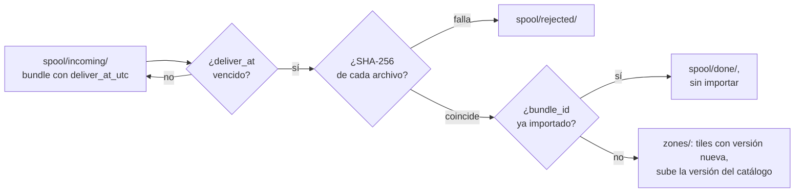

# Hábitat

El hábitat es el servidor local de la misión: recibe lo que manda la Tierra, lo sirve a las tablets
por Wi-Fi y junta las ediciones de todas. No ingiere datos de NASA ni hace aritmética de raster.
Qué lugar ocupa entre los otros dos ambientes, en [Los ambientes](./ambientes.md).

Los experimentos que esta página nombra (E10, E11) están en
[Reparto del trabajo](./reparto.md), con su criterio y su plan B.

## Servidor (D4)

**FastAPI + SQLite + tiles en disco + un bucle de importación en `lifespan` sobre un spool con
`deliver_at`.** Sin PostGIS, MinIO ni Celery. GeoPackage es opcional y solo en el hábitat. El
OpenAPI 3.1 se escribe a mano en H0 y se mockea con Prism, más un stub para los archivos
([Convenciones](./convenciones.md), sección "API (C3)").

- El catálogo son pocas zonas y una tabla de ediciones; los tiles son archivos estáticos.
- **El OpenAPI se escribe a mano** porque, si saliera de FastAPI, el mock no existiría hasta que
  hubiera código del servidor, y eso rompe la independencia del equipo (U9).
- **La importación va en `lifespan`** porque `BackgroundTasks` corre "after returning a response"
  y la importación no tiene petición ([FastAPI](https://fastapi.tiangolo.com/tutorial/background-tasks/),
  S12).
- **GeoPackage no sirve de caché en la tablet**: exige `tile_data` PNG/JPEG/WebP y triggers `ST_*`
  ([GeoPackage spec](https://www.geopackage.org/spec/), frente C §14–15).

El servidor corre en un portátil. Los eventos llegan a la tablet por **polling `since=`**.

Factibilidad en 48 h: **alta**.

La concurrencia de escritura de SQLite es limitada, lo que es irrelevante con 6 tablets.

## Importación de bundles

Un bucle asyncio en `lifespan` revisa el spool (APScheduler es la alternativa). `spool/`
y `zones/` están en el mismo sistema de archivos.

*Dibuja: `docs/guide/chapters/habitat.md` § Importación de bundles*

- El bundle se importa cuando vence su `deliver_at`.
- Se verifican los SHA-256 de `bundle.json`; si un hash falla, el bundle va a `spool/rejected/`.
- **La importación es idempotente por `bundle_id`**: un bundle entregado dos veces se importa una.
- **La versión de un tile cambia solo al importar un bundle.** Las ediciones no la tocan. La
  versión viene escrita por Tierra; el hábitat la adopta y no reescribe `tile.json` ni `zone.json`
  ([Tierra](./tierra.md), sección "Tiles (C1)").
- Tras importar, sube la versión del catálogo, que es el número de secuencia `since`, y los cambios
  quedan publicados para el polling.

El formato del bundle es C1b, en [Tierra](./tierra.md), sección "Bundle y spool con DELAY (C1b)".
El ritmo del bucle, el orden de importación, los demás motivos de rechazo y adónde va un bundle ya
importado: [Convenciones](./convenciones.md), sección "Protocolos entre ambientes".

## Los endpoints (C3)

C3 es un OpenAPI 3.1 recortado, en YAML a mano, con polling. Son 6 endpoints.

| Endpoint | Devuelve | Notas |
|---|---|---|
| `GET /zones` | Lista de zonas con versión (su `zone_version`) | El polling con `?since=` es el evento "zona nueva" |
| `GET /zones/{id}` | `zone.json` (origen ENU, CRS, tiles con versión, `layer_sources[]`, `pov[]`), tal como lo escribió Tierra, + **`conditions` (C6) vigentes** | Las condiciones viajan aquí; no hay endpoint propio |
| `GET /tiles/{zone}/{z}/{x}/{y}/{file}?v=` | Archivo del tile (C1) | `v` cambia **solo al importar un bundle**; las ediciones viajan como log |
| `GET /zones/{id}/pov/{file}?v=` | Imagen de un pin POV *(equipo)* | Igual que un archivo de tile: `v` es el `version` del pin y la tablet verifica su `sha256` |
| `POST /edits` | Ack por UUID | Batch, idempotente por UUID |
| `GET /zones/{id}/changes?since=` | Ediciones ganadoras, versiones de tile nuevas (por bundle) y **`conditions` actualizadas** desde `since` | Reanudable. Qué es una ganadora: sección "Log de ediciones y merge (D5)" |

Los campos de `zone.json`: [Tierra](./tierra.md), sección "Tiles (C1)". Qué es `since`, los
errores, la paginación, los límites, lo que C3 no tiene, y cómo se mockea y se valida (**E10**):
[Convenciones](./convenciones.md), sección "API (C3)".

La forma de cada respuesta *(equipo)*; P2 la transcribe a `openapi.yaml`, y escribe un fixture
completo de cada una en `contracts/fixtures/api/`, con su esquema
([Convenciones](./convenciones.md), sección "Cómo se fija un contrato"):

| Endpoint | Cuerpo |
|---|---|
| `GET /zones` | `{next_since, zones[]}`, con `{zone_id, name, zone_version}` por zona. Trae solo las zonas cuyo `zone_version` cambió después de `since`; con `since=0`, todas |
| `GET /zones/{id}` | `{zone_version, zone, conditions}`: `zone` es el `zone.json` y `conditions` el `conditions.json`, sin tocar |
| `POST /edits` | pide `{edits[]}`; responde `{acks[]}`, con `{uuid, status, code}` por edición |
| `GET /zones/{id}/changes` | `{next_since, has_more, edits[], tiles[], conditions}`: `tiles[]` como en `zone.json`; `conditions` solo si cambió |

El ejemplo de `changes` en `openapi.yaml` lleva `has_more: false`: con otro valor, un cliente
contra Prism no termina de paginar.

La tablet vuelve a pedir `GET /zones/{id}` en dos casos *(equipo)*: cuando `changes` trae
versiones de tile nuevas, y cuando `GET /zones?since=` trae una zona que ya tiene, con un
`zone_version` mayor que el cacheado *(propuesta)*. El segundo caso cubre un bundle que no cambia
ningún tile, como un `zone_update` que solo añade pines POV. El `zone.json` nuevo trae los
`tiles[]`, los `layer_sources[]` y los `pov[]` vigentes.

En qué página de `changes` van `tiles[]` y `conditions` cuando hay más de una:
[Convenciones](./convenciones.md), sección "API (C3)".

## Log de ediciones y merge (D5)

**Las ediciones son un log append-only**: cada una lleva UUID, reloj de Lamport y autor. El hábitat
las fusiona con **LWW por entidad, "max hazard wins" y tombstones**. No hay CRDT de librería.

- Las ediciones son entidades vectoriales, no texto colaborativo.
- **"Max hazard wins"**: nadie baja un peligro marcado por otro sin confirmar (R4).
- **El hábitat solo fusiona metadatos**, en Python y sin aritmética de raster (frente C §16,
  *inferencia de diseño*). El raster editado lo calcula la tablet; por qué hay una sola
  implementación, en [Tablet](./tablet.md), sección "`apply()` (D5)".

`Edit` (JSON Schema):

`{uuid, lamport (int), author, creator, zone_id, entity_id, op, payload, tombstone (bool)}`

`creator` *(equipo)* es el `author` de quien creó la entidad; lo llevan igual todas las ediciones
de esa entidad. Los valores de `op`, la forma de cada `payload`, de dónde sale `author` y cómo se
baja un peligro ajeno: [Convenciones](./convenciones.md), sección "Ediciones".

| Regla de merge | Cómo resuelve |
|---|---|
| LWW por `entity_id` | gana la última escritura en el orden `(lamport, author, uuid)` |
| `hazard` | el peligro de una celda es el `max` entero de sus entidades vivas |
| borrado | tombstone: la ganadora lleva `tombstone: true` |
| bajar un peligro ajeno sin `confirmed` | la edición se ignora entera |

### Qué guarda el hábitat y qué devuelve

*(equipo)*

- El hábitat guarda cada edición aceptada. Por cada `entity_id` calcula la **ganadora**: recorre
  las ediciones de la entidad en orden `(lamport, author, uuid)` y aplica las reglas de la tabla.
- **`changes?since=` devuelve solo ganadoras**: una edición por `entity_id`, la vigente de cada
  entidad cuya ganadora cambió desde `since`, tombstones incluidos. Una edición que perdió no
  viaja.
- El ack de `POST /edits` es `accepted` cuando la edición queda guardada, gane o no; `duplicate`
  si su `uuid` ya estaba; y `rejected` con `code: confirmation_required` cuando, al recibirla, la
  regla de confirmación la ignora: el hábitat recorre el log de la entidad con la edición
  incluida, en orden `(lamport, author, uuid)`, y mira si queda ignorada *(equipo)*. Una
  edición rechazada no se guarda.
- `log_in.json` y `log_merged.json` tienen la misma forma, `{schema_version, edits[]}`.
  `log_in.json` lleva las ediciones en orden de llegada. `log_merged.json` lleva solo las
  ganadoras, en orden `(lamport, author, uuid)`.

Factibilidad en 48 h: **alta**.

Pendientes y riesgos:

- El merge del hábitat y `apply()` en la tablet deben coincidir. Lo sostiene el golden de merge
  compartido, en `contracts/fixtures/merge/`. El servidor (pytest) comprueba que fusionar
  `log_in.json` da `log_merged.json`. La librería C# (`dotnet test`) comprueba que
  `apply(base, log_in)` y `apply(base, log_merged)` dan el mismo `sha256`, sobre el `base_tile/` de
  `contracts/fixtures/edits/`.
- Plan B si el hábitat llega a necesitar tiles editados: llamar al CLI `dotnet` por subprocess.

## Cálculo opcional en el hábitat

El hábitat puede correr optimizaciones largas, siempre opcionales y con fallback local en la
tablet:

- Optimización multi-astronauta/rover con OR-Tools (contrato C4). Queda fuera del MVP; quién la
  escribiría y dónde: [Reparto del trabajo](./reparto.md), sección "P3: motor de rutas y
  ediciones".
- El campo Dijkstra precalculado, si el benchmark de rutas falla en la tablet: es parte del plan B
  de [Tablet](./tablet.md), sección "Rutas (D7)".
