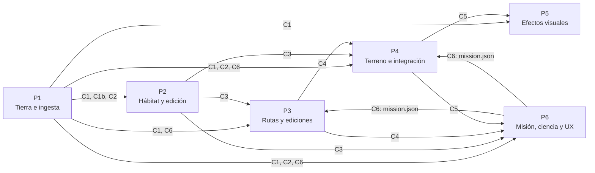
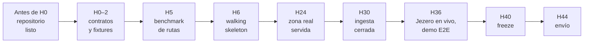

# Reparto del trabajo en 6 personas

Seis personas trabajan 48 h sin bloquearse entre sí (U9). Esta página dice quién construye qué, con
qué mocks, qué mide cada una y en qué orden se integra. No repite el diseño: cada fila enlaza la
sección que lo explica en [Los ambientes](./ambientes.md), [Tierra](./tierra.md),
[Hábitat](./habitat.md) o [Tablet](./tablet.md).

**La independencia se logra con contratos y fixtures fijados en H0–2** en `contracts/`, con
integración continua desde un walking skeleton en H6. No hay integración big-bang al final. Cómo
se fija un contrato y las reglas que cumple todo el equipo (una carpeta por dueño, un cálculo una
implementación, integración por reemplazo de mocks): [Convenciones](./convenciones.md).

**Las personas se nombran P1 a P6 en toda la guía** *(equipo)*: es un rol, no un nombre. Quién
ocupa cada rol lo acuerda el equipo fuera de la guía.

## Quién produce cada contrato

La tabla de productores y consumidores, con el orden en que se fijan, está en
[Convenciones](./convenciones.md), sección "Qué contratos se fijan y en qué orden". Qué fija cada contrato:
[Los ambientes](./ambientes.md), sección "Los contratos como interfaces".

*Dibuja: `docs/guide/chapters/convenciones.md` § Qué contratos se fijan y en qué orden*

Cada flecha se trabaja contra un mock hasta que el productor entrega: nadie espera a nadie.

## Dónde trabaja el equipo y quién tiene la tablet

*(equipo)*

- **El equipo trabaja presencial, en la misma red Wi-Fi**, las 48 h.
- **Hay una sola tablet y la custodia P4.** Cada experimento que la necesita lo ejecuta su
  responsable en la tablet, con su propio APK, en el turno de la tabla; E5, E7 y E9 usan el APK de benchmark de P4.
- **La segunda "tablet" de la demo de merge es el editor de Unity en un portátil**, con el
  `author` `ev2` *(propuesta)*: no hace falta otro dispositivo.
- **El equipo lleva un router propio**, para el portátil del hábitat y la tablet: una Wi-Fi de
  evento puede aislar a los clientes entre sí.
- Tierra y el hábitat corren en el portátil de P2, que por eso lleva también Python con GDAL y
  rasterio; la tablet lo alcanza por su IP local. P1 genera Gale en su portátil y la pasa al de
  P2 con su estado ([Tierra](./tierra.md), sección "Tiles (C1)").

La tablet se usa en este orden *(equipo)*; una fila no empieza hasta que acaba la anterior:

| Orden | Experimento | De quién | Cuándo |
|---|---|---|---|
| 1 | E2 | P4 | H0 |
| 2 | E10 | P2 | H0–H2 |
| 3 | E5 y E7 | P3 | H4–H5 |
| 4 | E1 | P5 | H5–H6 |
| 5 | E8 y E9 | P4, P3 | al acabar E1, antes de H6: son de minutos |
| 6 | el APK del walking skeleton | P4 | H6 |
| 7 | E3 y E4 | P5 | H6–H10, entre un build de P4 y el siguiente |

- E5 no cabe antes: el núcleo que mide se construye en H2–4. **Si E5 no ha empezado en H4:30,
  pasa E1 y E5 va detrás** *(propuesta)*: la tablet no espera a nadie.
- **E9 usa la escena y el APK de benchmark de P4** *(propuesta)*: P3 escribe el script que lee
  `fixtures/edits/`, llama a `Edits.Apply` y compara cada `sha256`, y lo sube a
  `tablet/Assets/Terrain/Scenes/` con un PR que aprueba P4, que le pone un botón.
- E3 y E4 miden los efectos completos, que en H6 aún no existen: por eso van después del
  walking skeleton, que sale con el perfil que dio E1.
- E10, E8 y E9 no miden la GPU: si la tablet está ocupada, se adelantan en cualquier otro Android
  y se repiten en la tablet antes de H6.

## P1: datos, ingesta y proceso Tierra

| | |
|---|---|
| **Construye** | El ambiente [Tierra](./tierra.md) completo: los adaptadores `stac`/`ode`/`wmts`/`json-feed`/`pds-http` (DONKI va por `json-feed` y RAD por `pds-http`) de "Fuentes de datos (D10, C2)"; el CLI `ingest` con `--delay`, la selección de asset por datum y su QA, y la reproyección, de "Ingesta (D3)", según C0; los rasters de pendiente, relieve y peligro (`uint8`), los tiles, `zone.json` y los pines POV, de "Tiles (C1)"; `conditions.json` y el escenario `SEP`, de "Condiciones (C6)"; los bundles en el spool, de "Bundle y spool con DELAY (C1b)" |
| **Antes de H0** | corre E12 y E13, y fija el bbox y el centro de Jezero y el `habitat_enu_m` de las dos zonas, que aprueba P6: [Contexto del reto](./contexto.md), sección "La zona elegida (D9)" |
| **En H24** | entrega Gale: sin empaquetar para el APK ([Tablet](./tablet.md), sección "Caché local"), y el tar con su carpeta de estado para el portátil de P2 ([Tierra](./tierra.md), sección "Tiles (C1)") |
| **Desde H30** | es dueño del video (≤30 s) y de la página del proyecto, y hace el envío de H44 *(equipo)* |
| **Produce** | C1 (con `zone.json`), C1b, C2 y el `conditions.json` de C6. En H0–2 escribe C1 y el esquema de C1b, cuyo fixture arma P6; C2 lo escribe P6 y C6 `conditions.json` lo escribe P5 ([Convenciones](./convenciones.md), sección "Qué contratos se fijan y en qué orden") |
| **Consume como mock** | un GeoTIFF local commiteado, como mock de NASA; el JSON de DONKI/RAD cacheado; C0 |
| **Carpeta** | `ingest/` |

Experimentos a su cargo:

| # | Experimento | Ventana | Criterio de éxito | Plan B si falla |
|---|---|---|---|---|
| E11 | Spool con `DELAY`: importar `fixtures/bundle_synth/`. **Compartido con P2** | H2–H6 | Entregado dos veces → importado una (idempotente); con un byte alterado → `rejected/`; la zona aparece en `GET /zones?since=` ≤ 5 s después de `deliver_at` | Retardo simulado con una espera en el CLI y copia directa a `zones/` (se pierde el spool, no la demo) |
| E12 | Inercia térmica. Gale: `gdal_translate -projwin` del bbox de Gale sobre `/vsicurl/` del `.cub` 30S120E, reproyectado a ENU. Jezero *(equipo)*: descargar el GeoTIFF de Edwards & Buz de [Zenodo 4931348](https://zenodo.org/api/records/4931348) y reproyectar a ENU el bbox de Jezero | Antes de H0 | Gale: recorte en ≤ 60 s y ≤ 5 MB. Las dos: valores en J m⁻² K⁻¹ s⁻½ plausibles (> 0) sobre la zona | Gale: descarga única del `.cub` (2,5 GB) antes de la hora 0; plan C: solo IR de 8 bit, etiquetado cualitativo. Jezero: solo IR de 8 bit, cualitativo |
| E13 | QA de datum por zona: 5 puntos de control comparando el DTM elegido con HiRISE y MOLA (TiTiler `/cog/point` con `coord_crs=IAU_2015:49900` y host `s3.us-west-2`) | Antes de H0 | Diferencia absoluta ≤ 100 m frente a MOLA en todos los puntos (un `dem` sobre esfera daría ~570 m). Si se mezcla CTX con HiRISE: sesgo mediano restado y escalón residual ≤ 5 m en la costura | No mezclar: fuera de la cobertura HiRISE la celda queda bloqueada (ya es bloqueo duro en el costo) y CTX solo se usa como contexto visual |
| E14 | **Lo corre P5 en H0–2; el plan B es de P1.** Radiación: DONKI en CCMC (ventana ≤ 60 días) y lectura por rangos de `TOT_DOSE_B/E` del último sol de RAD; leer el SIS de RAD para elegir B o E | H0–H2 | 200 sin key en `WSAEnlilSimulations`, `SEP` y `FLR`; tasa base en 4–10 µGy/h (el sol 4710 fue 5,9–6,7); JSON cacheado en `ingest/cache/h0/` con fecha | Key personal de `api.nasa.gov`; si tampoco, el JSON cacheado el 2026-11-12. Si B/E no se aclara: usar el mayor de los dos *(inferencia conservadora)* |

## P2: servidor del hábitat y edición

| | |
|---|---|
| **Construye** | El ambiente [Hábitat](./habitat.md) completo: FastAPI, el catálogo SQLite y los tiles en disco, de "Servidor (D4)"; el bucle de importación desde el spool, de "Importación de bundles"; `changes?since=` y el resto de "Los endpoints (C3)"; el log de ediciones con sus reglas de merge (en Python, sin aritmética de raster) y la spec de ops de `Edit`, de "Log de ediciones y merge (D5)" |
| **Produce** | C3: `openapi.yaml`, los cuatro fixtures de `contracts/fixtures/api/` con sus esquemas, la implementación y el golden de merge. En H0–2 revisa además C1b, y escribe el stub de archivos que sirve de mock de tiles ([Convenciones](./convenciones.md), sección "API (C3)") |
| **Consume como mock** | los fixtures C1 y C6 servidos desde disco; `fixtures/bundle_synth/` |
| **Carpeta** | `server/` |

Si el plan B de rutas se activa, P2 sirve el campo precalculado ([Hábitat](./habitat.md), sección
"Cálculo opcional en el hábitat").

Experimentos a su cargo (además de E11, compartido con P1):

| # | Experimento | Ventana | Criterio de éxito | Plan B si falla |
|---|---|---|---|---|
| E10 | Los dos mocks de C3, con los comandos de [Convenciones](./convenciones.md), sección "API (C3)": Prism para los endpoints JSON y el stub para los archivos | Antes de H0: que Prism resuelve un `$ref` a un archivo dentro de `examples`, con un YAML de juguete, en el portátil. H0–H2 (15 min): el stub, en cuanto existe el tile de P1; Prism, en cuanto `openapi.yaml` tiene ejemplos | Desde la tablet, por la IP de la red local, con su navegador para los GET; el `POST /edits` se prueba con `curl` desde otro portátil de la misma red *(propuesta)*. Cada endpoint JSON devuelve 200 con su ejemplo, que es el fixture de `contracts/fixtures/api/` referenciado por `$ref`, y `GET /tiles/synth/0/0/0/height.r16` devuelve los 132 098 bytes del fixture con su `sha256`. Node ≥ 24.18 instalado en los 6 equipos | Si Prism no resuelve los ejemplos por `$ref`: `openapi.yaml` los copia y un job de CI comprueba que coinciden con el fixture. Si Prism falla del todo: el stub sirve también los ejemplos JSON de `contracts/fixtures/`, y Prism queda solo para validar con `prism proxy` |

## P3: motor de rutas y ediciones

| | |
|---|---|
| **Construye** | Los componentes `Routing` y `Edits` de la [Tablet](./tablet.md): una librería C# netstandard2.1 sin `UnityEngine`, con la **fórmula del costo (única)**, de "Costo de caminata (D6)"; el heap propio, A\* 16-conexo + suavizado, el campo al hábitat, las 3 alternativas, Held-Karp/2-opt y el límite por radiación, de "Rutas (D7)"; y **`apply()`** con golden hashes, de "`apply()` (D5)" (la spec de las ops es de P2) |
| **Benchmark** | del núcleo (heap, campo Dijkstra y A\* sin suavizado), con protocolo, en H4–H5: E5. **P3 escribe el benchmark y P4 la escena y el APK** *(equipo)*: el benchmark es `Benchmark.Run`, C# puro dentro de `Routing` ([Tablet](./tablet.md), sección "Contrato de rutas (C4)"), que P3 corre también con `dotnet` en su portátil. P4 escribe en H2–4, contra la firma de H0:45, la escena `tablet/Assets/Terrain/Scenes/BenchmarkSandbox.unity`: un botón que llama a `Benchmark.Run` y un texto con lo que devuelve, que también va a logcat; para E7, un segundo botón que lo corre en `Task.Run` mientras la escena mide el frametime. P4 construye ese APK en H4 |
| **Orden de recorte si falta tiempo** | orienteering → 2-opt → las alternativas (queda solo la más rápida) *(equipo)* |
| **Produce** | C4, `cost_params.json`, `expected_route.json`, `fixtures/edits/`, `Routing/BENCHMARK.md`. Qué deja en H2 y qué entra con el código: [Tablet](./tablet.md), sección "Contrato de rutas (C4)" |
| **Consume como mock** | `costgrid_synth.bin` + grillas patológicas (muro, laberinto, nodata); un `mission.json` de ejemplo; el golden de merge de P2; tests con `dotnet test` |
| **Carpeta** | `Routing/` y `Edits/` |

Orden de trabajo *(equipo)*. Las horas de cada pieza están en [Tablet](./tablet.md), sección
"Rutas (D7)":

| Ventana | Qué construye |
|---|---|
| H0–2 | C4: lo que no depende de código |
| H2–4 | el núcleo: heap propio, campo Dijkstra y A\* 16-conexo sin suavizado, con la fórmula del costo, y el cuerpo de `Benchmark.Run`. Lo miden E5 y E7 en H4–H5 |
| H4–6 | `apply()` y sus `expected_NN.sha256` (E9); `BuildGrid` desde un tile |
| H6–12 | suavizado, `ReturnField` y `DurationLimit`; regenera `expected_route.json` |
| H12–24 | las 3 alternativas y `OrderStops` con Held-Karp |
| H24–36 | greedy + 2-opt y orienteering: lo primero que se recorta |

**Decisiones de P3 que tocan a otros dueños** *(propuesta de P3)*. El trabajo de P3 es
independiente y completo: P3 no espera a nadie para cerrar C4. Donde C4 necesita algo de otro
dueño, P3 lo decide, lo escribe en la sección de la guía que le toca, marcado *(propuesta de
P3)*, y lo lista aquí. Cada dueño lo revisa después, y una corrección entra por un PR normal; si
cambia la firma de C4, por "Cómo se cambia después de H2" ([Convenciones](./convenciones.md)):

| Decisión | Dueño que la revisa | Dónde está |
|---|---|---|
| `Terrain` traduce el `op` con `EditOpText`; un `op` desconocido se descarta con una línea de log | P4 | [Tablet](./tablet.md), sección "Orquestación" |
| `Terrain` guarda el último `Field` y se lo pasa a `OrderStops`; llama a `ReturnField` cuando cambian la grilla o la base | P4 | [Tablet](./tablet.md), sección "Orquestación" |
| `t_utc` de `DurationLimit` y `OrderStops` es la hora UTC a la que `Terrain` procesa `RouteRequested` | P4 | [Tablet](./tablet.md), sección "API de `Routing`" |
| Los asmdef de `Terrain`, `FX` y `HUD` referencian `Routing` y `Edits` por nombre | P4 | [Convenciones](./convenciones.md), sección "Archivos" |
| `.gitignore` (con `.build/`), `global.json` (SDK 10.0.404) y `.gitattributes` entran en el PR de C4 como copias exactas de los de `p4/skeleton` | P4 | [Convenciones](./convenciones.md), sección "Forja y carpetas" |
| `validate.py` ignora un `.gitkeep` vacío en `contracts/fixtures/`, que `p4/skeleton` deja para conservar la carpeta | P6 | [Convenciones](./convenciones.md), sección "Cómo se fija un contrato" |

La optimización con OR-Tools queda fuera del MVP. Si se hace, P3 la escribe en `server/optim/` y
P2 aprueba el PR, como dueño de `server/` *(equipo)*.

Experimentos a su cargo:

| # | Experimento | Ventana | Criterio de éxito | Plan B si falla |
|---|---|---|---|---|
| E5 | Benchmark del núcleo de rutas (heap propio, campo Dijkstra y A\* 16-conexo **sin suavizado**) en IL2CPP ARM64 Release ("Faster runtime", sin script debugging): grillas con semilla 1000²/2000²/4000² (uniforme, fractal, muro con hueco, laberinto, 30 % bloqueado); 20 corridas tras 3 de calentamiento. **P4 aporta la escena y el APK** (fila "Benchmark" de arriba) | H4–H5 | Tramo de 500 m: p95 ≤ 100 ms. Campo Dijkstra completo en 2000²: ≤ 2 s en hilo de fondo. 0 recolecciones de GC por consulta. Memoria ≤ 90 MB. Resultados en `Routing/BENCHMARK.md` | Grilla de 4 m + weighted A\* ε = 1,5 + campo precalculado en el hábitat (lo sirve P2). Plan C: wrapper Burst/HPC# solo si el tramo sigue > 100 ms |
| E6 | `new System.Collections.Generic.PriorityQueue<int,float>()` en un script de Unity con ambos perfiles de API | **Cerrado el 2026-11-12** | Error de compilación CS0234 en los dos perfiles de API de Unity 6000.3.28f1 y en netstandard2.1: el heap propio es obligatorio | Ninguno necesario |
| E7 | Campo Dijkstra en `Task.Run` dentro del APK de benchmark | H4–H5 | Durante el cálculo, el p95 de frametime de la UI sube ≤ 2 ms respecto al reposo | Trocear el campo en una corrutina (N celdas por frame) o precalcularlo en el hábitat |
| E9 | Equivalencia de `apply()` x64 frente a ARM64: escena en la tablet que recalcula los `expected_NN.sha256` de `fixtures/edits/` | H6 | N/N hashes iguales (N ≥ 5: hazard max, tombstone, polígono, bajada sin confirmar, orden concurrente) en `dotnet test` y en la tablet | Localizar la op con float y pasarla a entero; si no, los polígonos se limitan a rectángulos alineados a la rejilla *(equipo)* |

Los umbrales de E5 vienen del protocolo de medición de frente A §4.

## P4: terreno 3D, streaming e integración

| | |
|---|---|
| **Construye** | El componente `Terrain` de la [Tablet](./tablet.md): carga de tiles, LOD, skirts y cámara orbital, de "Mundo y tiles (D2)"; el material del terreno, con el tinte de niebla lejana, de "Contrato de escena (C5)"; el cliente C3, la caché local (archivos + SQLite con gilzoide), la copia de Gale desde el APK y la llamada a `apply()`, de "Caché local"; y la orquestación de rutas y ediciones (llamar a `Routing` y a `Edits`, emitir los eventos), de "Orquestación" |
| **Integrador** | dueño de `Main.unity`, del build Android (cada 4 h), y de la escena y el APK de benchmark (sección "P3: motor de rutas y ediciones"), sobre el motor de "Motor y ficha del dispositivo (D1)". Reparte los `author` de las tablets ([Convenciones](./convenciones.md), sección "Ediciones") y desempata los cambios de contrato |
| **Antes de H0** | prepara el repositorio: la sección "Antes de H0". El job de contratos y `map.json` no son suyos: son de P6 |
| **Produce** | C5, con `AppConfig` y el cargador de fixtures: [Tablet](./tablet.md), sección "Contrato de escena (C5)" |
| **Consume como mock** | Prism para los endpoints JSON y el stub de archivos para los tiles ([Convenciones](./convenciones.md), sección "API (C3)"); o `fixtures/` en StreamingAssets, sin red |
| **Carpeta** | `tablet/Assets/Terrain/` + `Main.unity` |

Experimentos a su cargo (además del APK de E5):

| # | Experimento | Ventana | Criterio de éxito | Plan B si falla |
|---|---|---|---|---|
| E2 | Ficha de la unidad real: `adb shell cat /proc/meminfo`, versión de Android y de One UI | H0 | RAM identificada (6 u 8 GB) y Android anotados en el README; presupuesto de memoria de la app ≤ 25 % de `MemTotal` | Con 6 GB: grilla de rutas ≤ 90 MB y texturas de capa a ½ resolución |
| E8 | `gilzoide/unity-sqlite-net` 1.3.3 en Unity 6000.3, IL2CPP ARM64, stripping Medium | H6 | `CreateTable` + 1000 `Insert` + `Query` devuelve 1000 filas, 0 excepciones, en la tablet | `Assets/link.xml` + stripping Minimal. Plan C: log `edits.jsonl` append-only + catálogo JSON, sin SQLite |

## P5: efectos visuales

| | |
|---|---|
| **Construye** | El componente `FX` de la [Tablet](./tablet.md): los shaders de holograma, niebla cercana (una pasada analítica + pocas partículas), heatmap y resaltado de rutas, y los parámetros del tinte lejano, de "Efectos visuales (D8)". Escribe shaders y los Sub Graphs que el shader del terreno incluye; ese shader y su material son de P4 ("Contrato de escena (C5)"). También el prefab `Routes`, que dibuja la polilínea de `RouteSelected` |
| **Produce** | los shaders, los Sub Graphs del terreno y los prefabs `FX` y `Routes`. En H0–2 escribe además el esquema y el fixture de C6 `conditions.json`, corre E14 y hace el sondeo de endpoints de NASA ([Convenciones](./convenciones.md), sección "Qué contratos se fijan y en qué orden") |
| **Consume como mock** | una escena mock: un plano con `height.r16` sintético, `_HazardTex` con 2 manchas y una polilínea hardcodeada |
| **Carpeta** | `tablet/Assets/FX/` |

Experimentos a su cargo:

| # | Experimento | Ventana | Criterio de éxito | Plan B si falla |
|---|---|---|---|---|
| E1 | **P5 construye su APK**, como los de E3 y E4. Frametime de URP 6.3 en el Mali-G68: APK con escena vacía y con holograma básico; matriz de 6 combinaciones *(equipo)*: Vulkan/GLES3 × render scale 0,6/0,75/1, con `targetFrameRate` 30 y Frame Pacing on. Las de 60 fps y Frame Pacing off solo se miden si ninguna llega al criterio | H5–H6; el APK está construido en H5 | En la mejor combinación, p95 de frametime ≤ 33,3 ms (30 fps estables) con holograma; objetivo ≤ 16,7 ms. La escena muestrea `_HeightTex` (R16_UNORM) y `_HazardTex` (R8) sin artefactos | Render scale 0,6, sin HDR ni bloom, GLES3 y `targetFrameRate = 30`; si aun así no llega, wireframe y scanlines fuera. Si R16_UNORM no se muestrea bien, `_HeightTex` pasa a RFloat por un cambio de C5 *(equipo)* |
| E3 | Coste de bloom, niebla y holograma: vista Overdraw + Mali System Metrics a la resolución objetivo; bloom on/off | H6–H10 | Con todos los efectos, p95 ≤ 33,3 ms; bloom ≤ 4 ms; ≤ 3 capas blended por píxel en la vista con niebla | Niebla = solo tinte en el terreno (sin partículas); bloom apagado y brillo aditivo en el propio shader |
| E4 | Native RenderPass y framebuffer fetch en Vulkan (no se usa en shaders propios; comprobar que URP no lo rompe) | H6–H10 | 0 crashes y 0 artefactos en 5 min de cámara orbital, también al rotar la tablet | Native RenderPass off; si persiste, GLES3 |

## P6: misión, ciencia y UX

| | |
|---|---|
| **Construye** | El componente `HUD` de la [Tablet](./tablet.md): el HUD (topográfico, óptico, térmico, radiación con `basis`) y los pines POV con crédito por ítem, de "HUD e indicadores (D10)"; los objetivos científicos y `mission.json`, de "Misión (C6)"; el modo edición (gestos, polígono, diálogo de confirmación), de "Orquestación"; y la posición del astronauta y los toggles de capa, de "HUD e indicadores (D10)" y "Contrato de escena (C5)". También la pantalla de ajustes y la del `author`, sobre `AppConfig` ([Tablet](./tablet.md), sección "Contrato de escena (C5)"), el texto de limitaciones, la narrativa y el guion del video |
| **Antes de H0** | escribe el job de contratos (`contracts/validate.py` y su workflow) y `contracts/schemas/map.json`, y los mantiene *(equipo)*: [Convenciones](./convenciones.md), sección "Repositorio y flujo de trabajo". Copia el texto del reto a la guía y aprueba el `habitat_enu_m` que propone P1 |
| **Produce** | el `mission.json` de C6 y el prefab `HUD`. En H0–2 escribe además el esquema y el fixture de C2, y el fixture `bundle_synth/` de C1b |
| **Consume como mock** | `conditions.json` + la `Route` golden (C4) + un bus de eventos falso |
| **Carpeta** | `tablet/Assets/HUD/` |

P6 no tiene experimentos a su cargo. Usa uGUI con TextMeshPro y la tabla de cadenas de
[Convenciones](./convenciones.md), secciones "Unity" y "Presentación".

## Antes de H0

*(equipo)*

Antes de H0 solo se prepara infraestructura: **no se escribe código de producto.** Se empieza
cuanto antes. Los pasos van en orden; cada uno espera al anterior salvo donde se dice.

| Paso | Quién | Qué deja | Qué desbloquea |
|---|---|---|---|
| 1 | P4 | El repositorio: invita a los otros cinco, y cada uno acepta; el primer commit con `docs/`; carpetas por dueño, `.gitattributes`, LFS, `.editorconfig`, `README.md`, `global.json`, `.gitignore` y `main` protegida | todo lo demás |
| 2 | P3 | Los dos paquetes vacíos de `Routing/` y `Edits/` ([Convenciones](./convenciones.md), sección "Repositorio y flujo de trabajo") | el paso 3 y la firma de H0:45 |
| 3 | P4 | El esqueleto de `tablet/`: proyecto Unity 6000.3.28f1 con URP, Force Text, las capas, un asmdef por dueño, los prefabs vacíos `Terrain` y `HUD`, `Main.unity`, los paquetes (JSON, Input System, uGUI con TextMeshPro, y `Routing` y `Edits` en `manifest.json`), HTTP sin TLS permitido, el script que copia los fixtures y `config.default.json`. Y los jobs de CI que no son de contratos | los pasos 4 y 7 |
| 4 | P5 | Sus tres Sub Graphs sin efecto y los prefabs vacíos `FX` y `Routes`, con un PR; P4 los coloca en `Main.unity` y en el shader del terreno | C5 en H0 |
| 5 | P6 | El job de contratos en verde y `map.json`. Solo espera al paso 1 | todo PR de contrato de H0–2 |
| 6 | P6 | Comprueba en los 6 equipos las instalaciones y UnityYAMLMerge de la checklist. No espera a nadie | H0 sin instalar nada |
| 7 | P4 | **La prueba final:** un PR de prueba pasa el CI y se fusiona, y un APK vacío del esqueleto queda instalado en la tablet | que H0 empiece por los contratos |

En paralelo, sin orden: P1 corre E12 y E13, fija los datos de zona y lee las guías de envío; P2
adelanta la mitad de E10; P6 copia el texto del reto; P4 comprueba el cupo de LFS, prepara el
router y anuncia la hora de reloj de H0.

**Si las reglas del evento no permiten este trabajo previo** *(equipo)*, lo que P1 confirma al
leer las guías de envío, los pasos 2 a 5 y el 7 pasan a H0 y la ventana de contratos se alarga lo
que tarden.

## Hitos

*Dibuja: `docs/guide/chapters/reparto.md` § Hitos*

**H0 es el inicio oficial del hackathon en la sede local** *(equipo)*, y Hn es n horas después.
La guía no escribe su hora de reloj: P4 la anuncia al equipo antes de H0, con la hora de reloj de
H44.

| Hito | Entregable |
|---|---|
| **Antes de H0** | El repositorio, el CI, el esqueleto de `tablet/` y los paquetes vacíos están en `main`, sin código de producto, y la prueba final pasó: sección "Antes de H0" |
| **H0–2** | C0–C6 y C1b con fixtures, JSON Schema y OpenAPI; los goldens de C4 que dependen de código entran después ([Tablet](./tablet.md), sección "Contrato de rutas (C4)"). Prism 5.16.0 fijado y los dos mocks de C3 levantados. Sondeo de endpoints NASA y caché en el repo (P5). Experimentos E2, E10 y E14. Abrir la página del proyecto (P1) |
| **H5** | Benchmark de rutas en la tablet (E5 y E7, en H4–H5): se decide grilla de 2 m o plan B |
| **H6 walking skeleton** | APK en la tablet real: tile sintético + cámara orbital + A\* trivial dibujado + holograma básico + un indicador de HUD + los mocks de C3 levantados + un tile real generado por P1 + bundle sintético importado. El A\* dibujado es el de `PlanRoute` sobre el tile sintético si `BuildGrid` está en `main` en H5:30; si no, `expected_route.json` *(equipo)*. Antes de H6 P4 prueba su APK en cualquier otro Android. Experimentos E1, E8, E9 y E11 cerrados. E3 y E4 se cierran en H10 |
| **H24** | Zona real (DTM + ≥3 capas) servida por el servidor real; costo real; niebla leyendo el raster real; HUD con condiciones reales; una edición que cambia el costo y re-planifica. P1 entrega Gale para el APK y P4 la empaqueta ([Tablet](./tablet.md), sección "Caché local"). P6 fija las paradas de la misión de Gale sobre los tiles reales, en nodos sin bloqueo *(propuesta)*. Guion del video iniciado |
| **H30** | Ingesta cerrada; P1 pasa a dueño del video y la página |
| **H36** | U2 en vivo con Jezero (bundle con `DELAY`) + orden de paradas, con la misión de Jezero que P6 fija al llegar la zona; demo E2E completa; toma de respaldo del video. Se decide si hay build Web |
| **H40 freeze** | Solo bugs, rendimiento en tablet, edición del video (≤30 s, subtítulos en inglés), página en inglés con la lista de datasets y créditos |
| **H44 envío** | Envío completo y subido; lo hace P1 *(equipo)*. H44–48: colchón y ensayo, sin funcionalidades nuevas |

El repositorio ya existe ([Convenciones](./convenciones.md), sección "Repositorio y flujo de
trabajo"), y prepararlo antes del evento no espera a las guías de envío *(equipo)*.

## Experimentos H0–H10

Lo que la investigación no pudo cerrar leyendo se cierra midiendo. Cada experimento está arriba,
bajo su responsable. Los umbrales sin fuente son criterios de decisión de este diseño
*(inferencia)*.

| Ventana | Experimentos |
|---|---|
| Cerrado | E6 (P3) |
| Antes de H0 | E12 y E13 (P1) |
| H0 a H2 | E2 (P4), E10 (P2) y E14 (P5) |
| H4 a H5 | E5 y E7 (P3) |
| Hasta H6 | E1 (P5), E8 (P4), E9 (P3), E11 (P1 + P2) |
| H6 a H10 | E3 y E4 (P5) |

**Siguen NO VERIFICADOS y no se pueden cerrar midiendo**, así que se declaran en el pitch:

- el b de Tobler a 0,38 g ([Tablet](./tablet.md), sección "Costo de caminata (D6)");
- la conexión magnética de un SEP con Marte ([Tierra](./tierra.md), sección "Condiciones (C6)");
- el coeficiente dosis–columna entre Gale y Jezero ([Contexto del reto](./contexto.md), sección "La
  zona elegida (D9)").

## Checklist del equipo

- [ ] Leer las guías de envío 2026 antes de H0: duración del video, idioma, disclosure de IA, opción
  de 7 diapositivas, y qué trabajo previo al evento permiten (P1).
- [ ] Dejar el repositorio listo antes de H0: la sección "Antes de H0" (P4).
- [ ] Copiar antes de H0 el texto completo del reto y la pestaña *Resources* a una página nueva de
  esta guía, `docs/guide/chapters/reto.md`, y registrarla en `guide.json` (P6).
- [ ] Escribir antes de H0 el job de contratos y `map.json` (P6).
- [ ] Fijar antes de H0 el bbox y el centro de Jezero y el `habitat_enu_m` de Gale y de Jezero, y
  anotarlos en [Contexto del reto](./contexto.md) (P1; P6 aprueba el hábitat).
- [ ] Anunciar antes de H0 la hora de reloj de H0 y de H44 (P4).
- [ ] Llevar un router propio para el portátil del hábitat y la tablet (P4).
- [ ] Instalar antes de H0, en los 6 equipos: **Unity 6000.3.28f1** con el módulo Android Build
  Support, Node ≥ 24.18, el SDK de .NET 10 y Python 3.12 con `uv` (cada uno; lo comprueba P6).
- [ ] Configurar antes de H0 UnityYAMLMerge como herramienta de merge de git en cada máquina, con
  los dos comandos que P4 deja en el README (cada uno; lo comprueba P6).
- [ ] Subir antes de H0 los paquetes vacíos de `Routing/` y `Edits/`, que comprueban `Tests~/` y
  `.build/` con el SDK de .NET 10 (P3).
- [ ] Sondear endpoints en H0: STAC, ODE, Trek WMTS, feeds raw, waypoints, DONKI en
  `ccmc.gsfc.nasa.gov`, RAD PPI, con las URL de [Fuentes](./fuentes.md), sección "URL de sondeo
  de H0"; cachear el JSON en `ingest/cache/h0/` (P5; P1 aprueba el PR).
- [ ] Pedir una key personal gratuita de `api.nasa.gov` como respaldo de DONKI (el cupo de
  `DEMO_KEY` es 10 y se bloquea durante horas) (P1).
- [ ] Descargar antes de la hora 0 el `.cub` de inercia térmica 30S120E si E12 sale lento (P1).
- [ ] Escribir C1b (`bundle.json` + `fixtures/bundle_synth/`) y la tabla de factores DONKI en C6
  (P1 + P6 el bundle; P5 la tabla).
- [ ] Fijar Prism 5.16.0 y Node ≥ 24.18 en el README del repo (P4, con el texto de P2).
- [ ] Crear `contracts/fixtures/edits/` con sus entradas y el golden de merge compartido; los
  hashes entran con `apply()`
  (P3 + P2).
- [ ] Escribir en `cost_params.json` y en `mission.json` los valores de
  [Convenciones](./convenciones.md), sección "Valores fijados" (P3 + P6).
- [ ] Cerrar las tres comprobaciones de [Convenciones](./convenciones.md), sección "Por decidir en
  H0" (P1 + P3 + P4).
- [ ] Preparar la lista de créditos de la página: CC0 de STAC y Murray (citar Laura et al. 2023 y
  Dickson et al. 2023/2024), Fergason et al. 2006, Edwards & Buz (CC-BY-4.0), créditos por ítem de
  los POV; sin logos de NASA ni JPL en la app (P1 + P6).
- [ ] Texto de limitaciones del pitch: b sin dato a 0,38 g, umbrales de obstáculo por analogía
  USFS, rocas < 1,5 m invisibles desde órbita, radiación de Jezero modelada, SEP como escenario,
  térmico a 100 m (P6).
- [ ] Flag `--delay` comprimido (60–90 s) para el video y cuenta atrás visible en la consola de
  Tierra (P1).
- [ ] Abrir `murray-lab.caltech.edu/CTX/` en un navegador y copiar su texto de uso (no bloquea: la
  licencia CC0 ya sale de DataCite) (P1).
