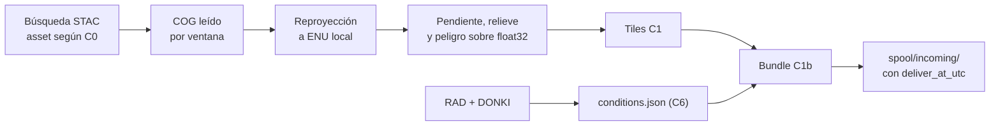

# Tierra

Tierra es el proceso que convierte datos de NASA en lo que el mapa consume. Es un CLI, `ingest`,
que corre en un portátil y simula el centro de control: busca los productos, los lleva a un sistema
de coordenadas local, calcula los rasters, corta los tiles y deja un bundle en el spool con un
retardo. Es el único ambiente que dispara ingesta; por qué, en [Los ambientes](./ambientes.md).

Los experimentos que esta página nombra (E11 a E14) están en
[Reparto del trabajo](./reparto.md), con su criterio y su plan B.

*Dibuja: `docs/guide/chapters/tierra.md` § Ingesta (D3)*

## Ingesta (D3)

**La ingesta es Python + GDAL/rasterio; el formato canónico es COG en IAU_2015; el descubrimiento
va por la STAC API de USGS**, con lectura por ventana vía `/vsicurl/`. Mars Trek WMTS se usa solo
para contexto. No hay Rust ni Go.

- El ecosistema planetario está en Python, y el cuello de botella es la descarga, no el tiling.
- Las reglas de ingesta son explícitas porque el asset `dem` de CTX en Gale está sobre la esfera,
  567–570 m por debajo del areoide, y los CTX de Jezero solo traen `dtm` (S1, S1b, S1c;
  [provenance CTX](https://astrogeo-ard.s3-us-west-2.amazonaws.com/mars/mro/ctx/controlled/usgs/T01_000815_1749_XN_05S222W__P22_009716_1773_XI_02S223W/provenance.txt);
  frente B §6). Esas reglas son C0, en [Convenciones](./convenciones.md), sección "Datos (C0)".

El pipeline: búsqueda STAC → COG por ventana → reproyección a ENU local → pendiente y rugosidad
sobre float32 → tiles C1. **La pendiente se calcula después de proyectar a ENU**: en Jezero la
equirectangular estira E-O ~5 %.

Factibilidad en 48 h: media-alta.

Pendientes y riesgos:

- CTX frente a HiRISE difiere +3…15 m en Gale (ajustado) y +10…47 m en Jezero según el ítem: hay
  QA de datum por zona (**E13**).
- Qué areoide exacto usa cada productor (GMM3 / GMM-2B) es **NO VERIFICADO**, e irrelevante para
  las pendientes.
- Existe un TiTiler de USGS (`astrogeology.usgs.gov/titiler`, sin SLA): solo se usa para QA.
- Licencias: GDAL MIT, rasterio BSD-3, PROJ MIT (frente B §13).
- Plan B de STAC: el ODE REST de PDS.

## Fuentes de datos (D10, C2)

Qué son los cuatro indicadores está en [Contexto del reto](./contexto.md). Aquí está de dónde sale
cada uno.

| Indicador | Productos, en orden de preferencia |
|---|---|
| **Topográfico** | DTM HiRISE (STAC) → DTM CTX (STAC) → MOLA (Trek WMTS/PDS) |
| **Óptico** | orto HiRISE (STAC) + Murray CTX 5 m + Trek WMTS de contexto + feeds raw de mars.nasa.gov + waypoints MMGIS (POV) |
| **Térmico** | **inercia térmica cuantitativa THEMIS** (USGS 32 bit, tiles 30S120E/30N060E; para Jezero: Edwards & Buz) + mosaicos IR día/noche de 8 bit (STAC) como contexto cualitativo |
| **Radiación** | RAD (PPI) + DONKI |

### Topográfico y óptico

- La fecha de un DTM HiRISE es el `START_TIME` de sus dos RDR fuente (etiqueta, o ODE con
  `pt=RDRV11`).
- **No hay producto de rocas a escala hiperlocal**: los obstáculos salen de rugosidad + pendiente.
- Los feeds raw y los waypoints no tienen versión: se cachean.
- Trek WMTS no declara licencia (aplican las pautas de medios de NASA).

### Térmico

Los mosaicos IR de STAC son "8-bit, qualitative"; sí hay inercia térmica (TI) cuantitativa
([STAC](https://stac.astrogeology.usgs.gov/api/collections),
[USGS TI](https://astrogeology.usgs.gov/search/map/themis_thermal_inertia_mosaic_quantitative_30s120e_100mpp),
[Zenodo 4931348](https://zenodo.org/api/records/4931348), S8, S9).

- El `.cub` de TI (2,5 GB) está teselado 128×128 (S13), pero la lectura por ventana no se midió →
  **E12**.
- Su elipsoide (3396,19/3376,2 km) no es la esfera de los COG: hay que reproyectar.
- La TI de Jezero es otro producto: el GeoTIFF de Edwards & Buz en Zenodo (1,7 MB, S8). Que se
  reproyecta a ENU con valores plausibles es **NO VERIFICADO** → **E12** *(equipo)*. Si falla,
  Jezero lleva solo `thermal_ir`.

### Radiación

- RAD va por la release 42 (hasta 2026-03-22), con `TOT_DOSE_B/E` en µGy/h y legible por rangos
  HTTP ([ERRATA RAD](https://pds-ppi.igpp.ucla.edu/data/MSL-M-RAD-3-RDR-V1.0/ERRATA.TXT), S3).
- **La tasa base medida** el sol 4710 (2025-11-05) fue 6,33–6,69 µGy/h en B y 5,93–6,15 µGy/h en
  E: 5,9–6,7 entre las dos (5 observaciones leídas por rangos, frente B §11).
- DONKI migró a `ccmc.gsfc.nasa.gov`, que responde sin key
  ([CCMC DONKI](https://ccmc.gsfc.nasa.gov/tools/DONKI/), S2).
- Qué dosis es la representativa, B (silicio) o E (plástico), es **NO VERIFICADO** → **E14**.
- `api.nasa.gov` con `DEMO_KEY` tiene un cupo de 10 y un bloqueo de horas (S2b); `FLR` dio 404
  allí, sin re-sondear.

### `LayerSource` (C2)

Cada fuente se describe con un `LayerSource`. Los nombres de campo vienen del diseño; el tipo y
la obligatoriedad son *(equipo)*:

| Campo | Tipo | Obligatorio | Contenido |
|---|---|---|---|
| `id` | string | sí | slug de C0 (`mro-hirise-dtm`) |
| `kind` | string | sí | `raster`, `timeseries`, `point` o `image` |
| `adapter` | string | sí | `stac`, `wmts`, `ode`, `json-feed` o `pds-http`: con qué adaptador se ingiere. `pds-http` *(propuesta)* es la lectura por rangos HTTP de un archivo de PDS, la de RAD; DONKI, los feeds raw y los waypoints son `json-feed` |
| `mission`, `instrument` | string | sí | como los nombra la fuente (`MRO`, `HiRISE`) |
| `product_id` | string | sí | el identificador del producto en su fuente |
| `resolution_m` | float | solo en `raster` | metros por píxel |
| `coverage_geojson` | objeto | no | una Geometry de GeoJSON, `Polygon` o `Point`, en lon/lat de C0 |
| `time_range` | `[string, string]` | sí | `[inicio, fin]` en el formato de fecha de C0; iguales si es un instante |
| `license` | string | sí | uno de los valores de la tabla de abajo |
| `url` | string | sí | de dónde se descarga, o la página del producto |
| `units` | string | no | la unidad del dato (`m`, `uGy/h`); se omite en una imagen |
| `vertical_datum` | string | solo en un DTM: un `raster` con `units` = `"m"` | `"areoid"` |
| `qualitative` | bool | sí | |

- **Cómo llega a la tablet** *(equipo)*: dentro de `zone.json`, en `layer_sources[]` (sección
  "Tiles (C1)"). No tiene endpoint ni archivo propio.
- `time_range` de un DTM HiRISE = [mín, máx] del `START_TIME` de sus dos RDR fuente. El `datetime`
  de STAC es un marcador.
- Una capa cualitativa lleva `qualitative: true`.

| Valor de `license` | Fuentes |
|---|---|
| `CC0-1.0` | STAC HiRISE/CTX/THEMIS, Murray CTX, MOLA ([DataCite](https://api.datacite.org/dois/10.17189/m23v-ae12), S7) |
| `CC-BY-4.0` | TI de Jezero (Edwards & Buz) |
| "Public domain, cite authors" | TI USGS (Fergason 2006) |
| "NASA media guidelines; crédito por ítem" | Trek, raw, waypoints |

## Tiles (C1)

Tierra corta cada zona en tiles de 257² con borde compartido. Por qué ese formato, en
[Tablet](./tablet.md), sección "Mundo y tiles (D2)". Los datos van a 1 m; la planificación de rutas
va a 2 m.

`tile.json` (JSON Schema):

| Campo | Contenido |
|---|---|
| `schema_version` | int |
| `zone_id` | string |
| `z, x, y` | int |
| `size_px` | 257 |
| `m_per_px` | float, m |
| `origin_enu_m` | [e, n], m |
| `height` | `{file, dtype:"uint16", scale, offset, nodata:65535, row_order:"north_up", endian:"le", vertical_datum:"areoid"}`; altura_m = offset + scale·valor |
| `layers[]` | las capas del tile; sus campos, en "Capas del tile" |
| `rasters.slope` | `{dtype:"uint8", unit:"deg"}` |
| `rasters.roughness` | `{dtype:"uint8", unit:"cm", window_m:3}`, satura a 255; es el relieve local del DTM float32: máximo menos mínimo de la altura en la ventana *(equipo)* |
| `rasters.hazard` | `{dtype:"uint8"}`, rango 0–255, **único** |
| `version` | int; el `zone_version` del bundle que trajo el tile |
| `sha256` | un objeto `{nombre de archivo: hash}`, con una clave por archivo del tile, capas incluidas |
| `source_ids[]` | fuentes del tile |

- Los tipos y la ventana de `slope` y `roughness` son *inferencia de diseño*.
- La rejilla `z, x, y`, los nombres de archivo, el redondeo y el `nodata` de los rasters `uint8`:
  [Convenciones](./convenciones.md), secciones "Datos (C0)" y "Rejilla y archivos de un tile".
- Qué valores escribe Tierra en `rasters.hazard`: [Convenciones](./convenciones.md), sección
  "Valores fijados".
- Pendiente, relieve y peligro se calculan sobre el float32 original, antes de cuantizar.
- El tile no lleva ningún raster de costo: Tierra no calcula costo
  ([Tablet](./tablet.md), sección "Costo de caminata (D6)").
- Fixture: `contracts/fixtures/tile_synth_0_0_0/`.

El tile sintético *(equipo)* es asimétrico a propósito, para que una inversión de filas o de
columnas se vea en cualquier consumidor. Es también el `base_tile` de `fixtures/edits/` y el mock
de `FX`. Sus coordenadas exactas, compartidas con los demás fixtures sintéticos, están en
[Convenciones](./convenciones.md), sección "Cómo se fija un contrato":

| Raster | Contenido |
|---|---|
| `height` | una rampa: sube 20 m de oeste a este y 5 m de sur a norte |
| `hazard` | 255 en un rectángulo del cuadrante noreste y en el `nodata`; 128 en uno más pequeño del suroeste; 0 en el resto |
| `nodata` | un cuadrado de 16 × 16 muestras en la esquina sureste |
| `slope`, `roughness` | 0, salvo `slope` = 20 dentro del rectángulo rojo |
| capas | las tres *(equipo)*, para que el `HUD` y el material prueben la leyenda, la rampa de color y la etiqueta `QUALITATIVE` sin datos reales: `ortho`, un degradado de oeste a este; `thermal`, un degradado de sur a norte; `thermal_ir`, un damero |

### Capas del tile

*(equipo)*

Cada entrada de `layers[]` de un tile es `{id, file}`. Lo que describe a la capa es igual en toda
la zona y va en `zone.json`, campo `layers[]`: `{id, dtype: "uint8", source_id, qualitative, unit,
scale, offset}`, con `unit`, `scale` y `offset` solo en una capa cuantitativa. Así el `HUD` tiene
la leyenda y el material su rango sin abrir ningún tile.

| `id` | `file` | Contenido |
|---|---|---|
| `ortho` | `ortho.r8` | la orto, en gris de 0 a 255: HiRISE, y CTX donde HiRISE no llega |
| `thermal` | `thermal.r8` | inercia térmica: valor = `offset + scale · muestra`, en J m⁻² K⁻¹ s⁻½, con el `scale` y el `offset` de `zone.json` |
| `thermal_ir` | `thermal_ir.r8` | el mosaico IR de día, de 8 bit; `qualitative: true` |

- Una capa va en la rejilla del tile: 257 × 257 muestras, con el formato binario de C0, y 0 donde
  no hay dato.
- Un tile solo lista las capas que tiene.
- Qué textura y qué toggle le corresponde a cada una: [Tablet](./tablet.md), sección "Contrato de
  escena (C5)".

### Versiones *(equipo)*

**La versión de un tile la pone Tierra**, no el hábitat.

- Tierra lleva un contador `zone_version` por zona y lo sube en cada bundle que emite, de cualquier
  `kind`.
- `tile.json.version` es el `zone_version` del último bundle que trajo ese tile. Un tile que un
  bundle no trae conserva su versión.
- El `?v=` de C3 es ese mismo número.
- El hábitat no reescribe `tile.json` ni `zone.json`: los sirve tal como llegaron, así que sus
  `sha256` siguen valiendo.
- La versión de una zona es el `zone_version` del último bundle importado para ella; es lo que
  devuelve `GET /zones`.

**El estado de Tierra vive junto al spool** *(equipo)*, en `spool/state/<zone_id>/`: `state.json`
(`{schema_version, zone_version}`), y el `zone.json` y el `conditions.json` vigentes.

- `ingest` lo lee antes de emitir un bundle de esa zona y lo reescribe después de dejar el bundle
  en `spool/incoming/`. Si la carpeta no existe, la zona es nueva y su primer bundle lleva
  `zone_version` 1.
- Es de P1: lo lee y lo escribe solo `ingest`. El hábitat no lo mira, y no tiene esquema en
  `contracts/`.
- **El estado viaja con el bundle.** P1 genera Gale en su portátil; al entregarla copia al
  portátil de P2, por la red local, el tar a `spool/incoming/` y la carpeta `spool/state/gale/`.
  Desde entonces todo bundle de Gale (el escenario `SEP`, una actualización) se emite en el
  portátil de P2, igual que Jezero.

### `zone.json`

`zone.json` describe una zona y lista sus tiles. Lo escribe Tierra; viaja en los bundles
`zone_full` y `zone_update`, siempre completo, y el hábitat lo sirve en `GET /zones/{id}`. Los
campos son *(equipo)*.

| Campo | Contenido |
|---|---|
| `schema_version` | int |
| `zone_id` | slug de C0 |
| `name` | string; el nombre que muestra el HUD |
| `crs` | `"IAU_2015:49900"` |
| `origin_lat_deg`, `origin_lon_deg` | el origen ENU, en las convenciones de C0. Es el centro del bbox de la zona *(equipo)*: en Gale, (−4.81, 137.385) |
| `origin_height_m` | altura del origen sobre el areoide |
| `projection` | `"equirectangular_local"` |
| `radius_m` | `3396190` |
| `habitat_enu_m` | `[e, n]`: dónde está el hábitat *(equipo)*. Es el `home` del campo de regreso que se calcula al arrancar, antes de que haya misión |
| `extent_enu_m` | `[e_min, n_min, e_max, n_max]`, **en metros enteros** *(equipo)*: `apply()` lo exige ([Tablet](./tablet.md), sección "Contrato de rutas (C4)"). Su esquina suroeste es el origen de la rejilla `x, y` |
| `base_m_per_px` | siempre `1.0`: el `m_per_px` de `z = 0` ([Convenciones](./convenciones.md), sección "Datos (C0)") |
| `tiles[]` | `{z, x, y, version, sha256}`; `sha256` es el de `tile.json`, que a su vez lleva el de cada archivo |
| `layers[]` | las capas que tiene algún tile de la zona, con su descripción: sección "Capas del tile" |
| `layer_sources[]` | *(equipo)* los `LayerSource` (C2) de todo lo que la zona usa, completos |
| `pov[]` | *(equipo)* los pines POV de la zona; sus campos, en "Pines POV" |

- **Proyección** *(equipo)*: con lat y lon en radianes y R = `radius_m`,
  e = R · cos(lat₀) · (lon − lon₀) y n = R · (lat − lat₀). La inversa da la lat/lon que muestra el
  HUD.
- **Niveles**: los que aparecen en `tiles[]`. Tierra produce desde `z = 0` hasta el nivel en que
  un solo tile cubre la zona *(equipo)*.
- `tiles[]` lista todos los tiles vigentes de la zona, también los que el bundle no trae.
- `zone.json` no lleva condiciones ni la versión de la zona: las condiciones van en
  `conditions.json` y la versión en `bundle.json`.
- Fixture: `contracts/fixtures/zone/`.

### Pines POV

*(equipo)*

Un pin POV es una imagen de rover situada en el mapa (S9). **Los pines viajan en `zone.json`, campo
`pov[]`, y sus imágenes son archivos del bundle.** Tierra los saca de los feeds raw y de los
waypoints. Los campos de cada pin son *(equipo)*:

| Campo | Contenido |
|---|---|
| `id` | slug, único en la zona |
| `source_id` | el `LayerSource` del que sale |
| `enu_m` | `[e, n]`: dónde se tomó la imagen |
| `t_utc`, `sol` | cuándo se tomó; `sol` es opcional (C0) |
| `file` | el nombre del archivo de imagen |
| `media_type` | `"image/jpeg"` |
| `sha256` | el del archivo |
| `version` | el `zone_version` del bundle que trajo la imagen; es el `?v=` con que se pide |
| `credit` | el crédito del ítem, copiado de su fuente (`image_credit` o `credit`) |
| `url` | la página del ítem en su fuente |

- La imagen es un JPEG con el lado mayor ≤ 1024 px *(equipo)*: Tierra la reduce al ingerir.
- Cómo la pide la tablet: [Hábitat](./habitat.md), sección "Los endpoints (C3)".
- El fixture de `zone.json` lleva un pin, con su imagen en `pov/` y su `LayerSource`.

## Condiciones (C6)

`conditions.json` lleva la radiación de una zona. Solo radiación. Viaja a la tablet dentro de C3.

| Campo | Contenido |
|---|---|
| `schema_version` | int |
| `source_id` | fuente del dato |
| `t_utc` | fecha del dato fuente |
| `sol` | opcional (int): el sol de la misión de origen, cuando la fuente lo trae (RAD), como fija C0 *(propuesta)* |
| `t_valid_utc` | cuándo aplica |
| `quantity` | `"dose_rate"` |
| `value` | float |
| `unit` | `"uGy/h"` |
| `uncertainty` | fracción, p. ej. 0.3 |
| `basis` | `"measured"` o `"modelled"` |
| `derived_from` | opcional, p. ej. "RAD Gale release 42" |
| `modifiers[]` | `{donki_activity_id (opcional), type, factor, valid_from, valid_to}`; `type` es un string libre: el tipo de actividad de DONKI, o `"SEP"` |

**Tasa efectiva = `value` × producto de los `factor` vigentes.**

| Tipo de actividad DONKI | Factor |
|---|---|
| `WSAEnlilSimulations` con impacto en "Mars" | 0,95 típico (mínimo 0,81) durante 1–3 días; es el único que modula de forma automática (decrecimiento Forbush, [Guo et al.](https://arxiv.org/pdf/1712.06885)) |
| `SEP` | 2,0: escenario de alerta. Solo existe si Tierra lo emite (sección "Escenario `SEP`") |
| resto | 1,0 |

- **Regla Forbush** *(inferencia de diseño)*: un factor < 1 (Forbush) se muestra en el HUD pero no
  alarga el límite de duración; un factor > 1 lo acorta.
- La conexión magnética de un SEP con Marte no se puede verificar por evento: por eso `SEP` es un
  escenario manual.
- Todo valor lleva `basis`: nada modelado parece medido. El caso de Jezero está en
  [Contexto del reto](./contexto.md), sección "La zona elegida (D9)".

La otra mitad de C6, `mission.json`, está en [Tablet](./tablet.md), sección "Misión (C6)".

### Escenario `SEP`

*(equipo)*

**El escenario `SEP` se activa en Tierra, con el CLI.** Ni el hábitat ni la tablet lo activan.

- `ingest conditions --zone gale --scenario sep --hours 24 --delay 90` emite un bundle `kind: "conditions"`.
- Su `conditions.json` lleva las condiciones vigentes más un modificador
  `{type: "SEP", factor: 2.0, valid_from, valid_to}`, sin `donki_activity_id`.
- Llega al hábitat con su `DELAY`, como cualquier dato de Tierra, y a la tablet por `changes`.
- El mismo subcomando sin `--scenario` reemite las condiciones con los modificadores DONKI
  vigentes.

## Bundle y spool con DELAY (C1b)

Todo lo que Tierra produce sale como un **bundle**: un tar sin comprimir, con el payload en `data/`
y un `bundle.json`. Lo importa el hábitat ([Hábitat](./habitat.md), sección "Importación de
bundles").

`bundle.json` (JSON Schema):

| Campo | Contenido |
|---|---|
| `schema_version` | int |
| `bundle_id` | ULID |
| `source` | `"earth"` |
| `zone_id` | la zona |
| `zone_version` | int monótono |
| `kind` | `zone_full`, `zone_update` o `conditions` |
| `created_utc` | cuándo se creó |
| `delay_s` | int |
| `deliver_at_utc` | cuándo puede importarlo el hábitat |
| `expires_utc` | opcional |
| `files[]` | `{path, size (bytes), sha256, media_type}`; `media_type` es `application/json`, `application/octet-stream` o `image/jpeg` *(propuesta)* |
| `payload_oxum` | "bytes.archivos", contando solo `files[]` |

Dentro del tar *(equipo)*:

| Ruta | En qué `kind` |
|---|---|
| `bundle.json` | todos; no aparece en `files[]` |
| `data/zone.json` | `zone_full`, `zone_update` |
| `data/conditions.json` | `zone_full`, `conditions`; opcional en `zone_update` |
| `data/tiles/{z}/{x}/{y}/{archivo}` | `zone_full`: todos los tiles; `zone_update`: solo los que cambian |
| `data/pov/{file}` | `zone_full`: todas las imágenes POV; `zone_update`: solo las nuevas |

- `files[].path` es la ruta dentro del tar (`data/zone.json`).
- `{archivo}` es cada archivo de un tile, con los nombres de [Convenciones](./convenciones.md),
  sección "Datos (C0)".
- Nombre en el spool: `{deliver_at:%Y%m%dT%H%M%SZ}_{zone}_{bundle_id}.tar`.
- Se escribe como `.tar.partial`, con `fsync`, y se renombra con `os.replace`: el hábitat nunca ve
  un bundle a medias.
- El retardo es el flag `--delay` de `ingest`; la consola de Tierra muestra la cuenta atrás hasta
  `deliver_at_utc`. Los valores de `DELAY` están en [Los ambientes](./ambientes.md).
- Qué pasa con un bundle caducado, atrasado o rechazado, y en qué orden se importan:
  [Convenciones](./convenciones.md), sección "Protocolos entre ambientes".
- Fixture: `contracts/fixtures/bundle_synth/`, sin empaquetar; quien lo prueba lo empaqueta. El
  spool completo se prueba en **E11**.

Fuentes: [RFC 8493](https://www.rfc-editor.org/rfc/rfc8493.html),
[os.replace](https://docs.python.org/3/library/os.html#os.replace), frente C §15.
